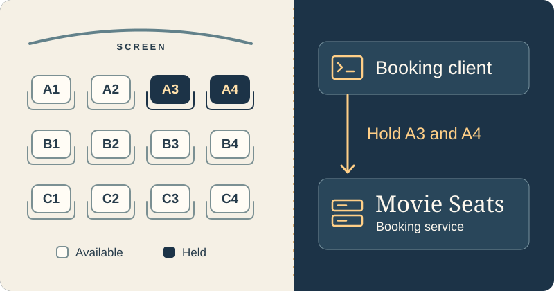

# Movie Seats

> **Disclaimer:** This repository is an educational example for showcasing the methodology
> of using Continuous Assurance skills. It is not a booking application intended for actual
> use. The code, build prompts, and recorded walkthrough demonstrate design, implementation,
> and verification through a small example scenario; they are not intended for real bookings
> or production use.

The [Continuous Assurance repository](https://github.com/hirendra-rathor/continuous-assurance)
provides two skills for applying a design methodology with a coding assistant.
The skills use six design perspectives to connect what a user expects with the parts of the system
responsible for that behavior and the tests that show whether it works.

- **Design Proposal** helps you compare a requested change with current behavior, review the design
  decisions, and agree on how to verify the result before implementation.
- **Explore Design** helps you understand how the system works today by tracing a question through
  its code, tests, and documentation.

Movie Seats uses reservations for a movie screening as an example scenario for applying
these skills. The runnable tutorial code uses FastAPI and SQLite to demonstrate seat availability,
holds, confirmation, cancellation, and expiration. If a caller asks for two seats together,
what must the example service check before it can book them together? You can follow that
question from the developer’s request through the proposed design to a check in the running example.



## Follow the recorded build

Read the [Markdown recordings](docs/recordings/README.md) or open the
[offline HTML walkthrough](docs/walkthrough/index.html) for the three prompts,
proposals, diagrams, implementation reports, and working-application screenshots.
The HTML reader works without starting the service.

## Work through the example

Install the skills by following the instructions in the [Continuous Assurance repository](https://github.com/hirendra-rathor/continuous-assurance).

Use the [three build prompts](docs/build-prompts.md) to work through the Movie Seats example
one milestone at a time. First, hold a complete selection of seats. Then confirm or cancel
a hold and recover a lost reply. Finally, release abandoned holds across service restarts.

Give your coding assistant one prompt at a time. Review the proposal, ask for any changes
you want, and then have the assistant implement the agreed design. Try the behavior yourself
and run the tests before moving to the next prompt.

## Run the example locally

Install [uv](https://docs.astral.sh/uv/getting-started/installation/) and then start
the example from the repository root.

```sh
uv run --locked uvicorn movie_seats.app:create_app --factory --host 127.0.0.1 --port 8000
```

Open [the API documentation](http://127.0.0.1:8000/docs) or inspect
[the screening](http://127.0.0.1:8000/screening). Run the tests from the same directory.

```sh
uv run --locked python -m pytest -q
```

Reservations are stored in `instance/movie-seats.sqlite3`; set `MOVIE_SEATS_DB` to use another file.
Holds last 300 seconds by default; `MOVIE_SEATS_HOLD_SECONDS` accepts 1–86400 seconds.
Existing holds receive a deadline once when upgrading, and confirmed bookings keep their seats.

For a container with persistent storage, run `docker compose up --build`.
Recreating the container retains its named data volume; deleting that volume deletes its reservations.

## License

The application and tutorial materials are available under the [MIT License](LICENSE).
