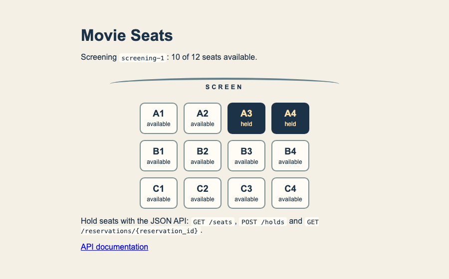
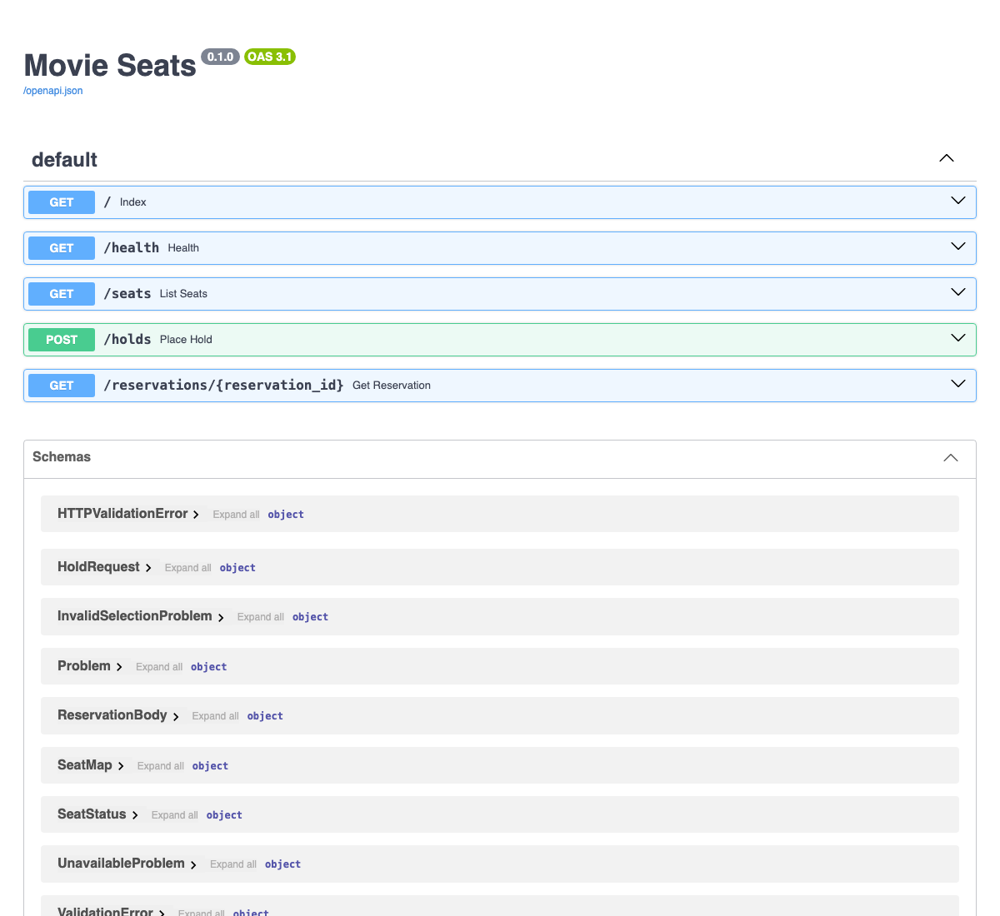

# Milestone 1: Hold a complete selection of seats

*Claude Code build.* [Recording index](README.md) · Built from the shared starter · [Milestone 1 implementation](../../../../tree/claude-milestone-1) · [Original recording](../../../../tree/claude-milestone-1-recording/docs/recordings/milestone-1)

The first milestone turns the starter's placeholder service into a seat-holding API.
A booking client lists the twelve seats, holds a selection all or nothing, and looks the hold
up by reservation ID after a restart. The decisive case is two clients asking for overlapping
seats at the same time.

**How to read this chapter.** The quoted proposal and implementation report use the milestone tags for Git revisions. The terminal output and screenshots come from the running service.

## Prompt

The [first build prompt](../build-prompts.md#1-hold-a-complete-selection-of-seats) is shown here with Claude Code’s skill command.

```text
I’d like to build a small movie booking service called Movie Seats.
Let’s start with one screening configured with twelve seats, A1 through A4,
B1 through B4, and C1 through C4. A booking client should be able to ask
which seats are available and request a hold on one or more of them.
I’d like to use Python and FastAPI for a JSON API I can call from a terminal,
with a local SQLite database for reservations.

People booking together need their complete selection. Two clients might ask
for overlapping seats at the same time, and a caller should get either
every seat it requested or no seats at all. When a hold succeeds, I’d like
the service to return a reservation ID the caller can use to look up the
reservation, even after the service restarts.

Give me a design proposal [use /ca-design-proposal].
```

*Editorial note.* Claude Code invoked the Design Proposal skill (`ca-design-proposal`) through its
skill tool with the argument `Milestone 1 of docs/build-prompts.md: Hold a complete selection of
seats`, and the proposal answers the prompt above.

## Design proposal (recorded)

The editable proposal figures are the [six-perspective overview](assets/milestone-1/diagrams/overview.svg) and the [collaboration diagram](assets/milestone-1/diagrams/collaboration.svg).

> A booking client needs to hold a group's complete seat selection at the Movie Seats screening, every requested seat or none, and to find that hold again by its reservation ID even after the service restarts.
>
> 
>
> **Comparison baseline.** I compared against the shared `starter` checkpoint on `claude/release`. In `movie_seats/app.py`, `create_app()` serves a placeholder page at `/` and `GET /health`. There are no seats, reservations or database yet. `pyproject.toml` already pins FastAPI and uvicorn, and `.gitignore` already excludes `instance/`. Apart from the health route and the app factory, everything below is new.
>
> ### Domain
>
> **Intentions.** Both come from your request. People booking together get their *complete selection*, never part of a group. A caller can *recover its hold* by reservation ID after a restart.
>
> **Concepts.** The *screening* has a fixed *seat layout* of twelve seats: A1–A4, B1–B4 and C1–C4. A *hold* claims seats for a *reservation*, identified by its *reservation ID*. A seat is *available* when no reservation holds it.
>
> **Rules.**
> - *All or nothing:* a hold claims every requested seat or none, and reports which requested seats were unavailable.
> - *One holder per seat:* no seat belongs to two reservations. When two requests overlap, the one that obtains the database write lock first is decided first; the other is then judged against the committed result. Arrival order at the HTTP layer doesn't decide it, and the second caller waits at most 5 s.
> - *Valid selection:* one or more distinct seats from the layout. An invalid selection holds nothing.
>
> The prompt leaves near-miss input open:
>
> | Input | Exact labels (recommended) | Lenient labels |
> | --- | --- | --- |
> | `["a3"]` | 422, unknown seat `a3` | 201, holds A3 |
> | `["A3", "A3"]` | 422, duplicate seat `A3` | 201, holds A3 once |
>
> I recommend exact labels: a terminal caller sees its mistake instead of holding something it didn't spell, and the contract stays easy to state. Nothing in this milestone releases a seat; confirmation, cancellation and expiry belong to the later prompts.
>
> ### Architecture
>
> The **booking client**, a terminal using `curl`, calls the **Movie Seats API**, one uvicorn process running the FastAPI app. Today that process keeps no state. Proposed: it owns the reservation rules and keeps reservations in a **SQLite database** file, `instance/movie-seats.sqlite3` by default or the path in `MOVIE_SEATS_DATABASE`. FastAPI runs synchronous handlers on a worker thread pool, so two holds can genuinely overlap. Each operation opens its own SQLite connection, and the database's write lock serializes the decision, which also holds if several processes later share the file.
>
> ![Sequence for two overlapping holds. Client 1 asks for A3 and A4 and client 2 for A4 and B1. Inside the Movie Seats API process the create_app routes call the reservation book; call 1 takes the SQLite write lock with BEGIN IMMEDIATE, finds A3 and A4 free, inserts and commits, and client 1 receives 201 with the reservation ID. Call 2 waits for the lock, then finds A4 held, rolls back, and client 2 receives 409 naming A4 while B1 stays available. After a restart a new process reads the same reservation from the SQLite file and returns 200. Gray means context, blue means changed and green means new.](assets/milestone-1/diagrams/collaboration.png)
>
> ### Subsystem Design
>
> Package `movie_seats`:
>
> | Package or module | Components | Today → Proposed |
> | --- | --- | --- |
> | `app.py` (changed) | `create_app` and routes | Placeholder page and `/health` → also prepares the database at startup, maps reservation-book results to HTTP responses and renders a read-only seat map at `/`. |
> | `screening.py` (new) | Seat layout | Missing → the screening ID and the twelve seat labels in row order. |
> | `reservations.py` (new) | Reservation book | Missing → lists availability, places all-or-nothing holds and looks up reservations. |
> | `database.py` (new) | Database setup | Missing → opens connections (5 s busy timeout, foreign keys, WAL journal) and creates schema version 1. |
>
> `place_hold` validates the selection against the layout, runs `BEGIN IMMEDIATE`, and selects any requested seats that are already reserved. It then either inserts the reservation and its seats and commits, or rolls back and raises `SeatsUnavailable`. A unique constraint on the reserved seat backs this up; if it ever fires, the caller sees the same 409.
>
> ### Subsystem Interfaces
>
> All three JSON endpoints are new; `GET /health` is unchanged.
>
> | Interface | Request | Responses |
> | --- | --- | --- |
> | `GET /seats` | none | 200 `{screening_id, seats: [{seat, status}]}`, with status `available` or `held`, in layout order. |
> | `POST /holds` | `{"seats": ["A3", "A4"]}` | 201 with the reservation body and `Location: /reservations/{id}`; 409 `{detail, unavailable_seats}`; 422 `{detail, invalid_seats}`; 503 if the lock wait times out. |
> | `GET /reservations/{id}` | none | 200 `{reservation_id, screening_id, status: "held", seats, created_at}`; 404 for an unknown ID. |
>
> Reservation IDs are random UUIDs, so they reveal nothing about order or volume. The entry page `/` replaces its placeholder sentence with the seat map and keeps its `/docs` link. If a 201 reply is lost, a retry in this milestone is a new request and gets 409 for its own seats; recovering lost replies is the second prompt's job.
>
> ### State Management
>
> | State element | Meaning and representation | Operations |
> | --- | --- | --- |
> | **Reservation** (new) | `reservations(reservation_id PK, screening_id, status, created_at)`; status is `held`. | Inserted by `POST /holds`; read by lookups. |
> | **Reserved seat** (new) | `reservation_seats(reservation_id FK, screening_id, seat_id)`, unique on `(screening_id, seat_id)`. | Inserted in the same transaction as its reservation; read to derive availability. |
> | **Schema version** (new) | `PRAGMA user_version = 1`. | Set when the file is created. A newer version stops startup, so later upgrades stay explicit. |
>
> Availability is derived from the layout minus reserved seats and is never stored separately. Because a reservation and its seats commit together, a crash mid-request leaves either the whole hold or nothing. The file survives restarts; deleting it deletes every reservation.
>
> ### Verification
>
> | Tests | Layer | Expected assertion |
> | --- | --- | --- |
> | Race for A4 (`tests/test_reservations.py`) | [component] | While the test holds the write lock, two threads call `place_hold(A3, A4)` and `place_hold(A4, B1)`. After release exactly one succeeds, the other raises naming A4, and only the winner's seats are reserved. If the check ran before taking the lock, both calls would see A4 free and the loser would fail on the constraint or, outside one transaction, leave B1 held. |
> | Selection rules (`tests/test_reservations.py`) | [component] | `D1`, `a3`, duplicates and an empty list are rejected; after a 409, B1 is still available. |
> | HTTP contract (`tests/test_api.py`) | [integration] | `GET /seats` lists twelve available seats; `POST /holds` for A3, A4 returns 201 with `Location`; the overlapping hold returns 409 naming A4; lookup returns 200; an unknown ID returns 404; a new `create_app` on the same file returns the same reservation. |
> | Restart lookup (`tests/test_end_to_end.py`) | [end-to-end] | A real uvicorn process receives concurrent overlapping holds and answers one 201 and one 409. After the process restarts, `GET /reservations/{id}` returns A3 and A4 held. |
> | Health and page (`tests/test_health.py`) | [integration], context | The health body is unchanged; the page keeps its heading and `/docs` link. |
>
> Run `uv run --locked python -m pytest -q`. I'll also rehearse the scenario by hand with `curl` against uvicorn and capture the seat map. The race check controls when both calls start waiting, not SQLite's internal scheduling, so it demonstrates the outcome under contention; the unique constraint covers schedules it doesn't produce.
>
> ### Decisions
>
> 1. Exact seat labels (recommended) or lenient normalization.
> 2. A 409 names the unavailable seats (recommended). It reveals that someone holds them, not who.
> 3. The database lives at `instance/movie-seats.sqlite3`, overridable with `MOVIE_SEATS_DATABASE`.
>
> You gave standing authorization to proceed from each completed proposal to implementation, so I'm implementing this design with the recommended choices. Tell me if you'd like any of them changed.

## Authorization to implement

*Editorial.* The developer's task instruction gave standing authorization to proceed from each
completed proposal to implementation without a separate approval. The proposal said so in its
closing paragraph, and Claude Code implemented it with the recommended choices. No separate
approval message was sent, and none is recorded here.

## Implementation report (recorded)

> I implemented the milestone 1 proposal in the commit tagged `claude-milestone-1` on `claude/release`. The commit holds application code and tests only; the recording files stay out of it.
>
> ### What changed
>
> | Module | Result |
> | --- | --- |
> | `movie_seats/screening.py` (new) | Seat layout `screening-1` with A1–A4, B1–B4 and C1–C4 in row order. |
> | `movie_seats/database.py` (new) | `connect()` opens a connection that manages its own transactions and waits up to 5 s for the write lock. `prepare_database()` switches the file to WAL, creates schema version 1 and refuses a newer version with `SchemaVersionError`. The path comes from `MOVIE_SEATS_DATABASE`, defaulting to `instance/movie-seats.sqlite3`. |
> | `movie_seats/reservations.py` (new) | `ReservationBook` with `seat_statuses()`, `place_hold()` and `get_reservation()`. `place_hold()` validates the selection, runs `BEGIN IMMEDIATE`, checks the requested seats, then inserts and commits or rolls back and raises `SeatsUnavailable`. A unique-constraint violation maps to the same conflict, and a lock timeout raises `ReservationBookBusy`. |
> | `movie_seats/app.py` (changed) | The lifespan prepares the database. New routes: `GET /seats`, `POST /holds` (201 with `Location`) and `GET /reservations/{reservation_id}`, with the 409, 422, 404 and 503 bodies from the proposal. The entry page now renders the seat map and keeps its `/docs` link. `/health` is unchanged. |
>
> ### Verification
>
> - `uv run --locked python -m pytest -q`: **26 passed** (2.45 s).
> - The two race checks passed in 15 repeated runs.
> - Live rehearsal with the README command, `uv run --locked uvicorn movie_seats.app:create_app --factory --host 127.0.0.1 --port 8000`, on the default database:
>   - `GET /seats` listed twelve available seats.
>   - Two `curl` processes sent `POST /holds` for A3, A4 and for A4, B1 at the same time. A3, A4 received **201** with reservation `c2bb69ce-b48d-4e7c-afd8-19266549b01a`; A4, B1 received **409** with `unavailable_seats: ["A4"]`.
>   - `GET /seats` then showed only A3 and A4 held; B1 stayed available.
>   - `["a3"]` and `["B1", "B1"]` returned **422** naming the seat; an unknown ID returned **404**.
>   - After I stopped and restarted uvicorn, `GET /reservations/c2bb69ce-…` returned **200** with the identical body, and A3 and A4 were still held.
> - Headless Chrome screenshots show the seat map after the hold, the seat map after the restart and the API documentation page.
>
> ### Departures from the proposal
>
> No behavior departs from the proposal. I added checks beyond the proposed table: `tests/test_database.py` [component] covers schema creation, re-preparing a file without losing reservations, and refusing a newer schema; one [component] and one [integration] check cover the 503 lock timeout. The seat map's held markers are checked in `tests/test_api.py`; `tests/test_health.py` is unchanged and still passes.
>
> ### Limitations
>
> - The race checks control when both holds start waiting, not SQLite's internal scheduling. Timing decided the live winner; the unique constraint covers schedules the checks don't produce.
> - Several uvicorn workers or processes sharing one file rely on the same SQLite lock but weren't exercised.
> - A lost 201 reply can't be recovered yet; that is the second prompt.

### Terminal acceptance rehearsal

*Editorial.* The server ran in the background with the milestone’s server command,
`uv run --locked uvicorn movie_seats.app:create_app --factory --host 127.0.0.1 --port 8000`, on
a fresh default database. The commands below ran from a scratch folder; the two holds were sent
by two `curl` processes started together.

*Recorded terminal output, before the restart:*

```console
$ curl -s http://127.0.0.1:8000/seats | python3 -m json.tool --compact
{"screening_id":"screening-1","seats":[{"seat":"A1","status":"available"},{"seat":"A2","status":"available"},{"seat":"A3","status":"available"},{"seat":"A4","status":"available"},{"seat":"B1","status":"available"},{"seat":"B2","status":"available"},{"seat":"B3","status":"available"},{"seat":"B4","status":"available"},{"seat":"C1","status":"available"},{"seat":"C2","status":"available"},{"seat":"C3","status":"available"},{"seat":"C4","status":"available"}]}

$ (curl -s -w ' HTTP %{http_code}\n' -X POST http://127.0.0.1:8000/holds -H 'Content-Type: application/json' -d '{"seats": ["A3", "A4"]}' > one.out &
 curl -s -w ' HTTP %{http_code}\n' -X POST http://127.0.0.1:8000/holds -H 'Content-Type: application/json' -d '{"seats": ["A4", "B1"]}' > two.out &
 wait); cat one.out two.out
{"reservation_id":"c2bb69ce-b48d-4e7c-afd8-19266549b01a","screening_id":"screening-1","status":"held","seats":["A3","A4"],"created_at":"2026-11-17T19:20:43Z"} HTTP 201
{"detail":"Some requested seats are not available.","unavailable_seats":["A4"]} HTTP 409

# The 201 reply's reservation ID: c2bb69ce-b48d-4e7c-afd8-19266549b01a

$ curl -s http://127.0.0.1:8000/seats | python3 -c 'import json,sys; print({s["seat"]: s["status"] for s in json.load(sys.stdin)["seats"] if s["status"] != "available"})'
{'A3': 'held', 'A4': 'held'}

$ curl -s -i http://127.0.0.1:8000/reservations/c2bb69ce-b48d-4e7c-afd8-19266549b01a | sed -n '1p;/^location/Ip;$p'
HTTP/1.1 200 OK
{"reservation_id":"c2bb69ce-b48d-4e7c-afd8-19266549b01a","screening_id":"screening-1","status":"held","seats":["A3","A4"],"created_at":"2026-11-17T19:20:43Z"}
$ curl -s -w ' HTTP %{http_code}\n' -X POST http://127.0.0.1:8000/holds -H 'Content-Type: application/json' -d '{"seats": ["a3"]}'
{"detail":"Unknown seats: a3.","invalid_seats":["a3"]} HTTP 422

$ curl -s -w ' HTTP %{http_code}\n' -X POST http://127.0.0.1:8000/holds -H 'Content-Type: application/json' -d '{"seats": ["B1", "B1"]}'
{"detail":"Each seat may be requested once: B1.","invalid_seats":["B1"]} HTTP 422

$ curl -s -w ' HTTP %{http_code}\n' http://127.0.0.1:8000/reservations/not-a-reservation
{"detail":"Reservation not found."} HTTP 404
```

*Editorial.* uvicorn was then stopped and started again with the same command and database file.

*Recorded terminal output, after the restart:*

```console
$ curl -s -w ' HTTP %{http_code}\n' http://127.0.0.1:8000/reservations/c2bb69ce-b48d-4e7c-afd8-19266549b01a
{"reservation_id":"c2bb69ce-b48d-4e7c-afd8-19266549b01a","screening_id":"screening-1","status":"held","seats":["A3","A4"],"created_at":"2026-11-17T19:20:43Z"} HTTP 200

$ curl -s http://127.0.0.1:8000/seats | python3 -c 'import json,sys; print({s["seat"]: s["status"] for s in json.load(sys.stdin)["seats"] if s["status"] != "available"})'
{'A3': 'held', 'A4': 'held'}
```

| Acceptance check | Observed |
| --- | --- |
| Twelve seats listed as available | Yes, A1 through C4 in layout order |
| Overlapping holds sent together | A3, A4: 201 with a reservation ID; A4, B1: 409 naming A4 |
| No partial hold | Only A3 and A4 held; B1 still available |
| Invalid selections | `a3` and a repeated `B1`: 422; unknown ID: 404 |
| Lookup after restart | 200 with the identical reservation; A3 and A4 still held |

## Screenshots of the working application

These screenshots were captured in headless Chrome during the terminal rehearsal.

### 1. A group holds two seats



*The entry page's seat map right after the overlapping holds: A3 and A4 are held.*

### 2. The hold survives a restart


*The same seat map after uvicorn was restarted on the same database file.*

### 3. The seat and reservation endpoints



*The API documentation page at `/docs`, listing the new endpoints and their schemas.*

## Navigation

[Recording index](README.md) · [Next milestone](milestone-2-confirm-or-cancel-a-hold-and-recover-a-lost-reply.md)
