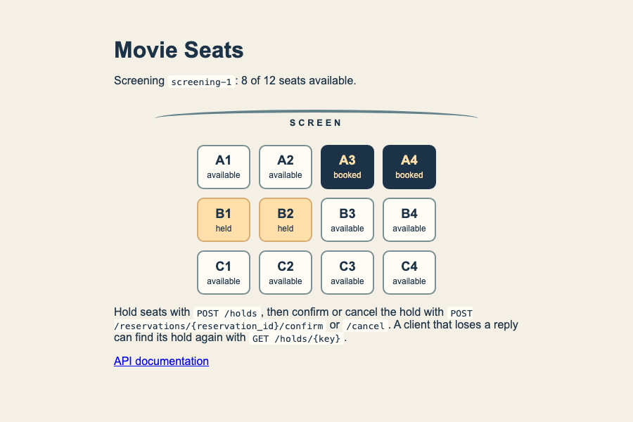
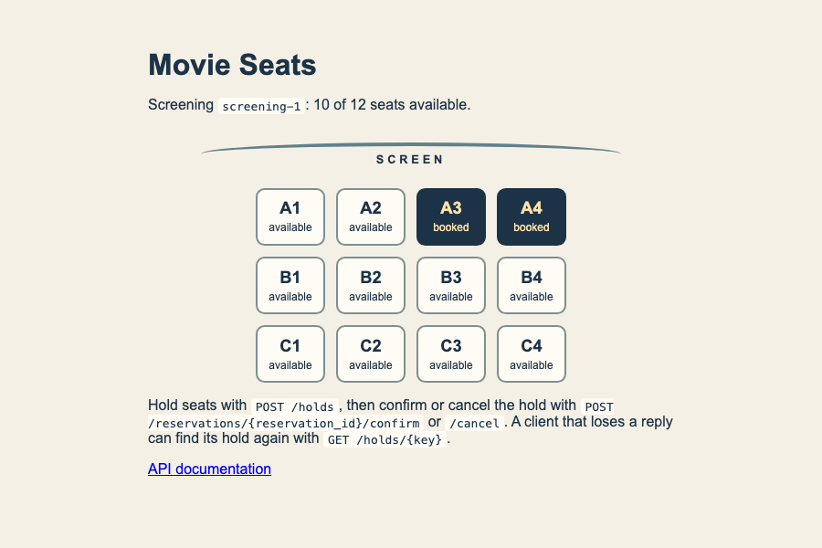
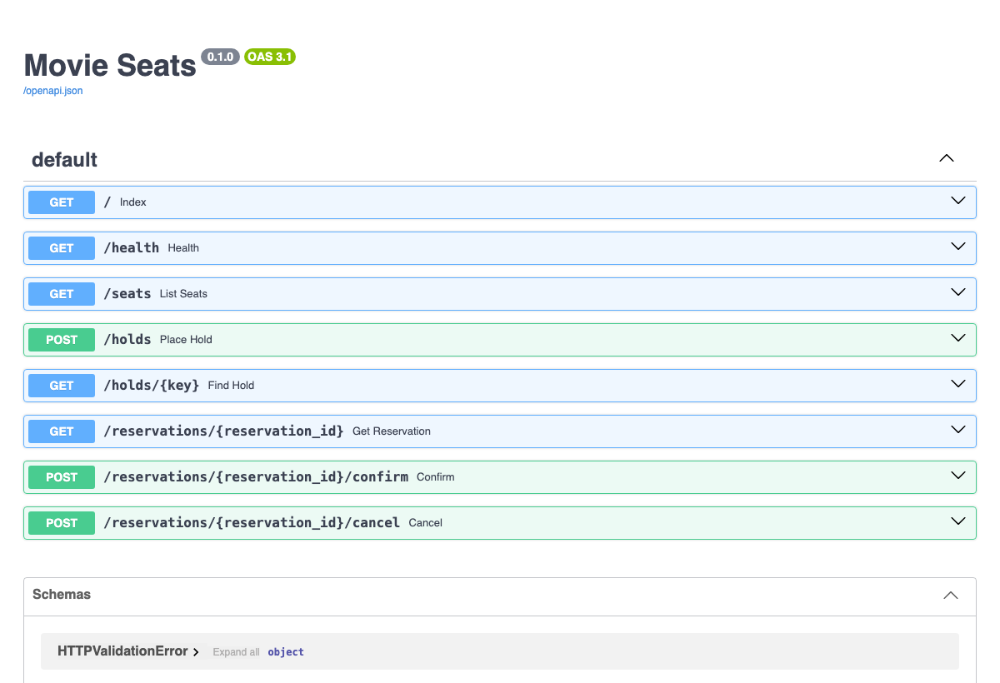

# Milestone 2: Confirm or cancel a hold and recover a lost reply

*Claude Code build.* [Recording index](README.md) · Built from milestone 1 · [Milestone 2 implementation](../../../../tree/claude-milestone-2) · [Original recording](../../../../tree/claude-milestone-2-recording/docs/recordings/milestone-2)

The second milestone lets a client settle a hold, by confirming or cancelling it,
and recover when a reply goes missing. The decisive cases are a hold whose 201 never reaches
the client, retried after a restart, and a hold made by the milestone 1 build that must still
be confirmable after the upgrade.

**How to read this chapter.** The quoted proposal and implementation report use the milestone tags for Git revisions. The terminal output and screenshots come from the running service.

## Prompt

The [second build prompt](../build-prompts.md#2-confirm-or-cancel-a-hold-and-recover-a-lost-reply) is shown here with Claude Code’s skill command.

```text
Movie Seats can now hold seats and return a reservation ID. I’d like a
client to be able to use that ID to confirm the booking or cancel the hold
so someone else can book the seats. This should work for holds made with
the first version too.

A client can lose the reply to a request. I’d like it to be able to retry
safely, even after the service restarts. If the lost reply was for the
original hold, the caller should be able to find out whether its seats were
held and recover the reservation ID. It should also be safe to repeat a
confirmation or cancellation.

Give me a design proposal [use /ca-design-proposal].
```

*Editorial note.* Claude Code invoked the Design Proposal skill (`ca-design-proposal`) through
its skill tool with the argument `Milestone 2 of docs/build-prompts.md: Confirm or cancel a hold
and recover a lost reply`, and the proposal answers the prompt above. The comparison baseline
was the milestone 1 implementation tagged `claude-milestone-1`.

## Design proposal (recorded)

The editable proposal figures are the [six-perspective overview](assets/milestone-2/diagrams/overview.svg) and the [collaboration diagram](assets/milestone-2/diagrams/collaboration.svg).

> A booking client needs to settle each hold, by confirming the booking or cancelling so others can book the seats, and to retry any request whose reply was lost, even across a restart, without holding seats twice or losing its reservation ID.
>
> ![Milestone 2 overview in six perspective columns. Rules for one-way status and one key per hold protect the intentions to settle a hold and to retry safely, which need the capability to settle and recover. The changed Movie Seats API runs changed routes and a changed reservation book that records status and key on the reservation; cancel releases reserved seats; database setup migrates the schema from version 1 to 2. The new Idempotency-Key header is sent with POST /holds. New checks cover key replay, a lost reply across a restart, status transitions and the version 1 upgrade. Blue means changed and green means new.](assets/milestone-2/diagrams/overview.png)
>
> **Comparison baseline.** Milestone 1 implementation (`claude-milestone-1`). `ReservationBook.place_hold()` in `movie_seats/reservations.py` always inserts a new reservation under a fresh UUID, so a retried `POST /holds` after a lost 201 gets 409 for its own seats and the caller can't learn its reservation ID. Reservations stay `held`: no operation changes status, and the `UNIQUE (screening_id, seat_id)` constraint on `reservation_seats` would stop a released seat from being reserved again. `prepare_database()` in `movie_seats/database.py` creates schema version 1 and refuses anything newer; there is no upgrade path.
>
> ### Domain
>
> **Intentions.** From your request: a client *settles the hold*, confirming the booking or cancelling so someone else can book the seats, including holds made by the first version; and a client can *retry safely* after a lost reply, even across a restart. Milestone 1's intentions, booking together and finding a hold by ID, remain.
>
> **Concepts.** A reservation's *status* is `held`, `confirmed` (a *booking*) or `cancelled`. A *hold key* is a value the client generates for one hold request and repeats on every retry of it. I propose the conventional `Idempotency-Key` header to carry it.
>
> **Rules.**
> - *One-way status:* `held` becomes `confirmed` or `cancelled`, and neither changes again. Repeating the request that produced the current status succeeds without a change; the other request is refused.
> - *Cancelling releases seats:* a cancelled reservation's seats are available at once; a confirmed booking keeps them.
> - *One key, one hold:* the first successful hold under a key is the only one. A retry with the same key and seats returns that reservation; the same key with different seats is refused.
>
> | Current status | `confirm` | `cancel` |
> | --- | --- | --- |
> | held | 200, now confirmed | 200, now cancelled; seats released |
> | confirmed | 200, unchanged | 409 |
> | cancelled | 409 | 200, unchanged |
>
> Two choices are open; each input below separates them:
>
> | Input | Recommended | Alternative |
> | --- | --- | --- |
> | `POST /holds` without a key, as milestone 1 clients send it | 201 as today; the hold works but can't be recovered by key | 400 until clients add a key, breaking existing callers |
> | Key K first got 409 for A4; A4 is later cancelled; the client retries with K | 201: only successful holds are recorded, so the retry is a fresh attempt | 409 again: K replays its first failure forever |
>
> I recommend an optional key, so milestone 1 callers keep working, and recording only successful holds, because nothing was held before and the client still wants the seats. Cancelling a confirmed booking is outside the prompt and gets 409.
>
> ### Architecture
>
> The **booking client** changes: today it sends seats only; now it generates a key per hold, such as a UUID, and keeps it until it has the reservation ID. The **Movie Seats API** stays one uvicorn process and gains confirm, cancel and key lookup. The **SQLite database** is upgraded in place from schema version 1 to 2 when the new build starts, before it accepts requests. Every write still runs under SQLite's write lock with `BEGIN IMMEDIATE`, so a confirm and a cancel racing for one hold apply in lock order, and two retries with one key can't both insert.
>
> ![Sequence for a lost hold reply. The booking client sends POST /holds for A3 and A4 with Idempotency-Key K; the reservation book checks K and the seats in one write transaction and commits reservation R with K, but the 201 reply is lost. After a restart, GET /holds/K returns R, and a retried POST /holds with K returns 200 with the same R without inserting. The client confirms R, that reply is lost too, and the repeated confirmation finds R confirmed and returns 200 without a change. Blue means changed.](assets/milestone-2/diagrams/collaboration.png)
>
> ### Subsystem Design
>
> Package `movie_seats`:
>
> | Package or module | Components | Today → Proposed |
> | --- | --- | --- |
> | `reservations.py` (changed) | Reservation book | `place_hold(seats)` and lookups → `place_hold(seats, key)` replays a recorded key inside the write transaction; new `find_by_key`, `confirm` and `cancel` apply the transition table; seat status adds `booked`. |
> | `database.py` (changed) | Database setup | Creates version 1 → applies numbered migrations in one transaction: a new file goes through versions 1 and 2, a version 1 file gets only the step to 2. |
> | `app.py` (changed) | `create_app` routes | Three JSON routes → three more, the key header on `POST /holds`, and booked seats on the seat map. |
>
> ### Subsystem Interfaces
>
> | Interface | Change |
> | --- | --- |
> | `POST /holds` (changed) | Optional `Idempotency-Key` header: 1–128 URL-safe characters (letters, digits, `-_.~`), such as a UUID. New hold: 201 as today. Recorded key, same seats in any order: 200 with the reservation's current state and the same ID. Same key, different seats: 422. |
> | `GET /holds/{key}` (new) | 200 with the reservation held under that key; 404 if none was recorded, meaning nothing is held under it and a retry is safe. |
> | `POST /reservations/{id}/confirm` and `/cancel` (new) | 200 with the reservation; 404 for an unknown ID; 409 `{detail, status}` for a refused transition. |
> | `GET /seats`, `GET /reservations/{id}` (changed) | Seat status adds `booked`; reservation status adds `confirmed` and `cancelled`. |
>
> A replay returns current state rather than a stored copy of the first reply. A key works like the reservation ID: anyone who knows it can read the reservation, so clients should use unguessable keys.
>
> ### State Management
>
> | State element | Today → Proposed | Operations |
> | --- | --- | --- |
> | **Reservation** (changed) | Status always `held` → `held`, `confirmed` or `cancelled`; new nullable `request_key`, unique where present. | A hold inserts it with its key; confirm and cancel update status; lookups by ID or key read it. |
> | **Reserved seat** (changed) | Unique per screening seat forever → new `released` flag; a partial unique index covers only unreleased rows. | Cancel marks the reservation's rows released; holds check unreleased rows. |
> | **Schema version** (changed) | 1 → 2. | The migration rebuilds `reservation_seats`, copies every row as unreleased, adds `request_key` and sets version 2, all in one transaction. |
>
> A version 1 file keeps every reservation, ID, timestamp and seat; its holds have no key and become confirmable and cancellable. If the migration fails, the transaction rolls back and the file stays at version 1. A version 1 build refuses the upgraded file instead of misreading it.
>
> ### Verification
>
> | Tests | Layer | Expected assertion |
> | --- | --- | --- |
> | Status transitions (`tests/test_reservations.py`) | [component] | Every cell of the transition table, including repeats. After A3, A4 is cancelled, a hold for A4, B1 succeeds; a confirmed booking's seats stay `booked`. |
> | Key replay (`tests/test_reservations.py`, `tests/test_api.py`) | [component], [integration] | The same key twice, including from two threads at once, yields one reservation and the same ID, and the second reply is 200. Different seats under the key give 422; a failed attempt leaves no record. |
> | Version 1 upgrade (`tests/test_database.py`) | [component] | A file built with the version 1 schema and a held reservation becomes version 2 with the row intact, and that hold confirms or cancels. A failure mid-migration leaves version 1. |
> | HTTP contract (`tests/test_api.py`) | [integration] | Confirm, cancel, 404 and 409 bodies; `GET /holds/{key}` 200 and 404; a replay through a new `create_app` on the same file. |
> | Lost reply (`tests/test_end_to_end.py`) | [end-to-end] | Against uvicorn: hold with a key and discard the reply; restart; `GET /holds/{key}` returns the ID; a retried `POST /holds` returns 200 with the same ID; confirming twice returns 200 both times; `/seats` shows `booked`. |
> | Milestone 1 checks | [component], [integration], [end-to-end], context | Still pass. |
>
> Run `uv run --locked python -m pytest -q`. For the rehearsal I'll start this build on the actual milestone 1 database from the last rehearsal, which holds A3 and A4 under reservation `c2bb69ce-…`, and confirm that hold. A discarded reply stands in for a lost one: the server commits before it replies, so it can't tell the difference.
>
> ### Decisions
>
> 1. Keep the key optional (recommended) or require it.
> 2. Record only successful holds under a key (recommended) or replay failures too.
> 3. Refuse to cancel a confirmed booking with 409 (recommended).
>
> Under your standing authorization I'm implementing this design with the recommended choices; tell me if you want any of them changed.

## Authorization to implement

*Editorial.* The developer's task instruction gave standing authorization to proceed from each
completed proposal to implementation without a separate approval. The proposal said so in its
closing paragraph, and Claude Code implemented it with the recommended choices. No separate
approval message was sent, and none is recorded here.

## Implementation report (recorded)

> I implemented the milestone 2 proposal in the commit tagged `claude-milestone-2` on `claude/release`, building on `claude-milestone-1`. The commit holds application code and tests only.
>
> ### What changed
>
> | Module | Result |
> | --- | --- |
> | `movie_seats/database.py` (changed) | Schema changes are numbered `MIGRATIONS`. A new file runs steps 1 and 2; a version 1 file runs only step 2, which adds `reservations.request_key` with a partial unique index, rebuilds `reservation_seats` with a `released` flag and a unique index over unreleased rows, and copies every seat row. All of it, including `user_version = 2`, commits in one transaction. |
> | `movie_seats/reservations.py` (changed) | `place_hold(seats, request_key)` returns a `HoldResult` and, inside the write transaction, replays a recorded key (same seats in any order) or raises `HoldKeyReused`. New `find_by_key`, `confirm` and `cancel` apply the transition table; cancel marks the reservation's seats released. Seat status adds `booked`. A shared transaction helper takes the write lock up front and maps a lock timeout to `ReservationBookBusy`. |
> | `movie_seats/app.py` (changed) | `POST /holds` reads the optional `Idempotency-Key` header and answers 200 for a replay. New routes: `GET /holds/{key}`, `POST /reservations/{reservation_id}/confirm` and `POST /reservations/{reservation_id}/cancel`, with the 404, 409 and 422 bodies from the proposal. The seat map shows held seats in amber and booked seats in dark blue. |
>
> ### Verification
>
> - `uv run --locked python -m pytest -q`: **58 passed** (5.60 s), including all milestone 1 checks.
> - The five race checks (overlapping holds, one key from two threads, confirm against cancel, and the HTTP race) passed in 10 repeated runs.
> - Live rehearsal with the README command on the **actual milestone 1 database** from the previous rehearsal:
>   - Before startup the file reported `user_version` 1 and held reservation `c2bb69ce-…`. After startup it reported 2.
>   - `GET /reservations/c2bb69ce-…` returned the milestone 1 hold unchanged. Confirming it twice returned **200** `confirmed` both times.
>   - A `POST /holds` for B1, B2 with key `4b9d2e81-…` had its reply discarded; `/seats` showed A3, A4 booked and B1, B2 held.
>   - After a restart, `GET /holds/4b9d2e81-…` returned reservation `eef506c4-…`, and retrying `POST /holds` with the key and the seats in reverse order returned **200** with the same reservation. The key with only B1 returned **422**.
>   - Cancelling `eef506c4-…` twice returned **200** `cancelled` both times; confirming it then returned **409**, and cancelling the confirmed `c2bb69ce-…` returned **409**. An unused key returned **404**. `/seats` finally showed only A3 and A4 booked.
> - Headless Chrome screenshots show the seat map with booked and held seats, the seat map after the cancellation and the API documentation.
>
> ### Departures from the proposal
>
> No behavior departs from the proposal. Additions: an [end-to-end] check starts uvicorn on a version 1 file and confirms its hold, and a malformed key in `GET /holds/{key}` returns 422 like the header does. The version 1 fixture in `tests/conftest.py` spells out the milestone 1 schema rather than calling the production migration, so it keeps describing the file that build actually wrote. Held seats on the seat map changed from dark blue to amber so booked seats can take the darker style.
>
> ### Limitations
>
> - Keys are global and there is no authentication: anyone who knows a key or a reservation ID can read the reservation, and anyone with the ID can settle it.
> - A replay returns the reservation's current state, not a byte-for-byte copy of the first reply.
> - The rehearsal discarded a reply after the server sent it; it didn't cut a connection mid-request. Both look the same to the server, which commits before replying.
> - `GET /holds/{key}` answers 404 both when a hold failed and when the request never arrived; in both cases nothing is held and a retry is safe.

### Terminal acceptance rehearsal

*Editorial.* This rehearsal reused the database file left by the milestone 1 rehearsal,
`instance/movie-seats.sqlite3`, which still held A3 and A4 under reservation
`c2bb69ce-b48d-4e7c-afd8-19266549b01a`. Commands ran from the repository root.

*Recorded terminal output, before the milestone 2 build started:*

```console
$ sqlite3 instance/movie-seats.sqlite3 'PRAGMA user_version; SELECT reservation_id, status FROM reservations;'
1
c2bb69ce-b48d-4e7c-afd8-19266549b01a|held
```

*Editorial.* The milestone 2 build then started in the background with the milestone’s server command,
`uv run --locked uvicorn movie_seats.app:create_app --factory --host 127.0.0.1 --port 8000`.

*Recorded terminal output, first run of the milestone 2 build:*

```console
$ sqlite3 instance/movie-seats.sqlite3 'PRAGMA user_version;'
2

$ curl -s -w ' HTTP %{http_code}\n' http://127.0.0.1:8000/reservations/c2bb69ce-b48d-4e7c-afd8-19266549b01a
{"reservation_id":"c2bb69ce-b48d-4e7c-afd8-19266549b01a","screening_id":"screening-1","status":"held","seats":["A3","A4"],"created_at":"2026-11-17T19:20:43Z"} HTTP 200

$ curl -s -w ' HTTP %{http_code}\n' -X POST http://127.0.0.1:8000/reservations/c2bb69ce-b48d-4e7c-afd8-19266549b01a/confirm
{"reservation_id":"c2bb69ce-b48d-4e7c-afd8-19266549b01a","screening_id":"screening-1","status":"confirmed","seats":["A3","A4"],"created_at":"2026-11-17T19:20:43Z"} HTTP 200

$ curl -s -w ' HTTP %{http_code}\n' -X POST http://127.0.0.1:8000/reservations/c2bb69ce-b48d-4e7c-afd8-19266549b01a/confirm
{"reservation_id":"c2bb69ce-b48d-4e7c-afd8-19266549b01a","screening_id":"screening-1","status":"confirmed","seats":["A3","A4"],"created_at":"2026-11-17T19:20:43Z"} HTTP 200

$ K=4b9d2e81-60fd-4c75-bd37-56b464efd309

$ curl -s -o /dev/null -X POST http://127.0.0.1:8000/holds -H 'Content-Type: application/json' -H "Idempotency-Key: $K" -d '{"seats": ["B1", "B2"]}'   # reply discarded

$ curl -s http://127.0.0.1:8000/seats | python3 -c 'import json,sys; print({s["seat"]: s["status"] for s in json.load(sys.stdin)["seats"] if s["status"] != "available"})'
{'A3': 'booked', 'A4': 'booked', 'B1': 'held', 'B2': 'held'}
```

*Editorial.* uvicorn was stopped and started again with the same command and database file.
The client still had only its key, `K`.

*Recorded terminal output, after the restart:*

```console
$ K=4b9d2e81-60fd-4c75-bd37-56b464efd309

$ curl -s -w ' HTTP %{http_code}\n' http://127.0.0.1:8000/holds/$K
{"reservation_id":"eef506c4-e829-43ba-afc9-0f32d5d93c38","screening_id":"screening-1","status":"held","seats":["B1","B2"],"created_at":"2026-11-17T19:34:48Z"} HTTP 200

$ curl -s -w ' HTTP %{http_code}\n' -X POST http://127.0.0.1:8000/holds -H 'Content-Type: application/json' -H "Idempotency-Key: $K" -d '{"seats": ["B2", "B1"]}'
{"reservation_id":"eef506c4-e829-43ba-afc9-0f32d5d93c38","screening_id":"screening-1","status":"held","seats":["B1","B2"],"created_at":"2026-11-17T19:34:48Z"} HTTP 200

$ curl -s -w ' HTTP %{http_code}\n' -X POST http://127.0.0.1:8000/holds -H 'Content-Type: application/json' -H "Idempotency-Key: $K" -d '{"seats": ["B1"]}'
{"detail":"This Idempotency-Key was already used for a different selection."} HTTP 422

$ H=eef506c4-e829-43ba-afc9-0f32d5d93c38

$ curl -s -w ' HTTP %{http_code}\n' -X POST http://127.0.0.1:8000/reservations/$H/cancel
{"reservation_id":"eef506c4-e829-43ba-afc9-0f32d5d93c38","screening_id":"screening-1","status":"cancelled","seats":["B1","B2"],"created_at":"2026-11-17T19:34:48Z"} HTTP 200

$ curl -s -w ' HTTP %{http_code}\n' -X POST http://127.0.0.1:8000/reservations/$H/cancel
{"reservation_id":"eef506c4-e829-43ba-afc9-0f32d5d93c38","screening_id":"screening-1","status":"cancelled","seats":["B1","B2"],"created_at":"2026-11-17T19:34:48Z"} HTTP 200

$ curl -s -w ' HTTP %{http_code}\n' -X POST http://127.0.0.1:8000/reservations/$H/confirm
{"detail":"This reservation is cancelled; it can't be confirmed.","status":"cancelled"} HTTP 409

$ curl -s -w ' HTTP %{http_code}\n' -X POST http://127.0.0.1:8000/reservations/c2bb69ce-b48d-4e7c-afd8-19266549b01a/cancel
{"detail":"This reservation is confirmed; it can't be cancelled.","status":"confirmed"} HTTP 409

$ curl -s -w ' HTTP %{http_code}\n' http://127.0.0.1:8000/holds/never-used-key
{"detail":"No hold was recorded under this key."} HTTP 404

$ curl -s http://127.0.0.1:8000/seats | python3 -c 'import json,sys; print({s["seat"]: s["status"] for s in json.load(sys.stdin)["seats"] if s["status"] != "available"})'
{'A3': 'booked', 'A4': 'booked'}
```

| Acceptance check | Observed |
| --- | --- |
| Upgrade keeps milestone 1 holds | Schema version 1 → 2; reservation `c2bb69ce-…` still held A3 and A4 |
| Confirm a milestone 1 hold, twice | 200 `confirmed` both times; A3 and A4 booked |
| Recover a lost hold reply after a restart | `GET /holds/K` returned reservation `eef506c4-…` |
| Retry the hold with the same key | 200 with the same reservation, seats given in another order |
| Key reused for other seats | 422 |
| Cancel twice, then confirm | 200, 200, then 409; B1 and B2 available again |
| Cancel a confirmed booking | 409 |
| Unused key | 404 |

## Screenshots of the working application

These screenshots were captured in headless Chrome during the terminal rehearsal.

### 1. A booking and a hold after the upgrade



*After the upgrade: the milestone 1 hold on A3 and A4 is confirmed, and the hold whose reply was
discarded holds B1 and B2.*

### 2. Cancellation releases the held seats



*After the restart and the cancellation: B1 and B2 are available again; the confirmed booking
keeps A3 and A4.*

### 3. The recovery and completion endpoints



*The API documentation page at `/docs` with the milestone 2 endpoints.*

## Navigation

[Recording index](README.md) · [Previous milestone](milestone-1-hold-a-complete-selection-of-seats.md) · [Next milestone](milestone-3-release-abandoned-holds.md)
