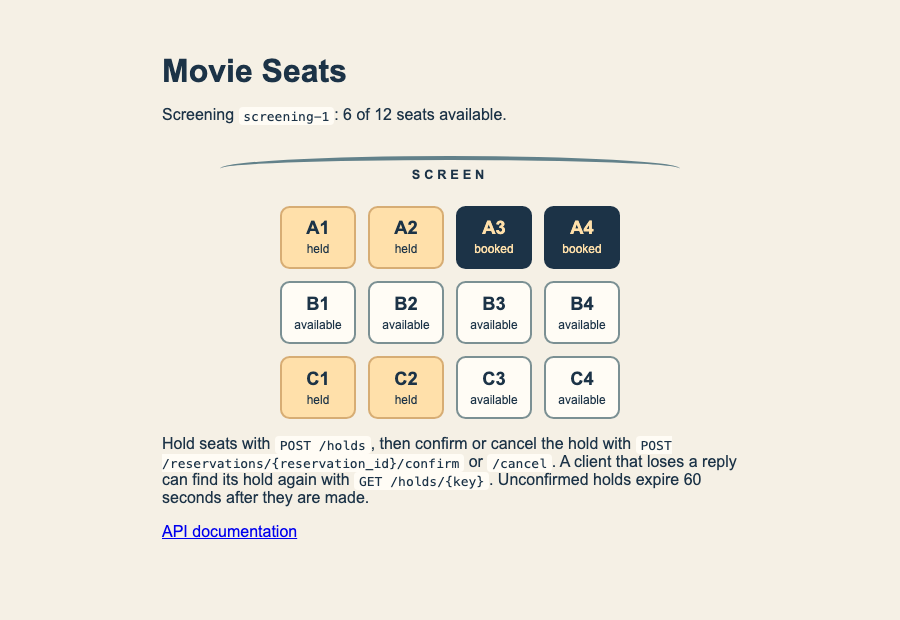
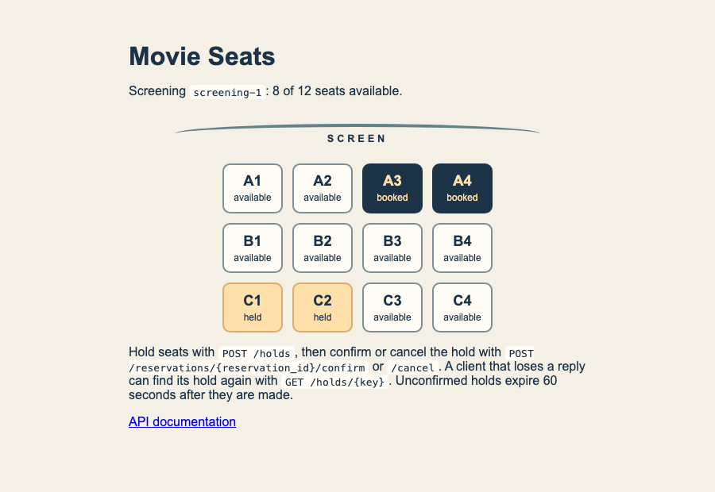
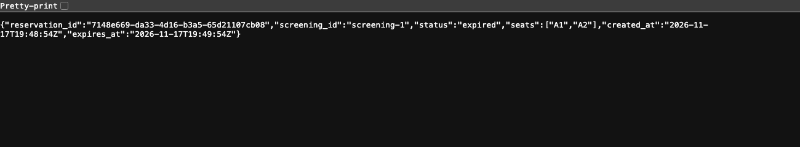

# Milestone 3: Release abandoned holds

*Claude Code build.* [Recording index](README.md) · Built from [milestone 2](milestone-2-confirm-or-cancel-a-hold-and-recover-a-lost-reply.md)

The third milestone gives every hold a deadline and runs the service in a
container. The decisive cases are a deadline that passes while no container is running, and a
hold made by the previous build that must survive the upgrade and then expire on its own.

**How to read this chapter.** The quoted proposal and implementation report identify revisions by milestone. The terminal output and screenshots come from the running service.

## Prompt

The [third build prompt](../build-prompts.md#3-release-abandoned-holds) is shown here with Claude Code’s skill command.

```text
Movie Seats now lets clients confirm or cancel a hold. I’d like each new
hold to have a time limit, and I’d like the service to tell the caller when
the hold expires. Once an unconfirmed hold expires, its seats should be
available for booking again. Confirmed bookings should keep their seats.

When we stop the service for maintenance or an upgrade, that downtime
should count toward the hold time. If a deadline passes while the service
is stopped, the seats should be available when it starts accepting requests
again.

Upgrading should preserve reservations made with earlier versions. I’d also
like to run the service in a container and keep those reservations when we
replace the container.

Give me a design proposal [use /ca-design-proposal].
```

*Editorial note.* Claude Code invoked the Design Proposal skill (`ca-design-proposal`) through
its skill tool with the argument `Milestone 3 of docs/build-prompts.md: Release abandoned holds`,
and the proposal answers the prompt above. The comparison baseline was the milestone 2
implementation.

## Design proposal (recorded)

The editable proposal figures are the [six-perspective overview](assets/milestone-3/diagrams/overview.svg) and the [collaboration diagram](assets/milestone-3/diagrams/collaboration.svg).

> Booking clients need seats from abandoned holds to return to sale at a deadline the holder is told in advance, even across downtime, and the operator needs upgrades and container replacements to keep every earlier reservation.
>
> ![Milestone 3 overview in six perspective columns. The intention to free abandoned seats needs timed holds, constrained by the rule that downtime counts; the intention to upgrade safely needs durable storage provided by a new data volume. A new container runs the changed Movie Seats API, whose changed routes and reservation book expire due holds under the write lock, set deadlines on reservations and release reserved seats; database setup migrates to version 3. New runtime settings set the hold time. New checks cover the version 2 upgrade, restarts and container swaps, HTTP expiry and the expiry boundary. Gray means context, blue means changed and green means new.](assets/milestone-3/diagrams/overview.png)
>
> **Comparison baseline.** In the milestone 2 implementation, a hold stores `created_at` but no deadline. In `movie_seats/reservations.py`, `seat_statuses()` treats every unreleased seat of a held reservation as taken, and only `cancel()` releases seats, so an abandoned hold keeps its seats forever. `prepare_database()` applies `MIGRATIONS` up to version 2, `create_app()` reads only `MOVIE_SEATS_DATABASE`, and the repository has no container definition.
>
> ### Domain
>
> **Intentions.** From your request: *free abandoned seats*, so an unconfirmed hold ends at a time limit the caller is told and its seats return to sale; and *upgrade safely*, so reservations from earlier versions survive the upgrade and a container replacement. The milestone 1 and 2 intentions remain.
>
> **Concepts.** A hold's *deadline*, `expires_at`, is a UTC wall-clock time fixed when the hold is made: its creation time plus the *hold time*. An *expired* reservation is a hold whose deadline arrived before it was confirmed or cancelled.
>
> **Rules.**
> - *Downtime counts:* deadlines are wall-clock instants, so time while the service is stopped counts. A hold is expired from its deadline onward, to the second.
> - *Expired is final:* expiry releases the seats; confirm and cancel then get 409 with `status: expired`, and a key replay returns the expired reservation. Confirmed bookings never expire.
>
> With a 600 s hold time, hold R made at 12:00:00 has `expires_at` 12:10:00:
>
> | Request at | R reported as | A3, A4 on `/seats` | `confirm R` |
> | --- | --- | --- | --- |
> | 12:09:59 | held | held | 200; the booking keeps the seats |
> | 12:10:00 | expired | available | 409 expired |
> | 12:15:05, after downtime 12:02–12:15 | expired | available | 409 expired |
>
> The prompt leaves two values open:
>
> | Question | Recommended | Alternatives |
> | --- | --- | --- |
> | Hold time | 600 s, set with `MOVIE_SEATS_HOLD_SECONDS` | Any other fixed value |
> | Deadline for a hold made by an earlier build (created 11:00, upgraded at 12:00) | Upgrade time plus hold time: held until 12:10, then expired | From `created_at`: expired at once on upgrade. None: held until someone settles it. |
>
> I recommend the grace period: it preserves earlier holds without keeping abandoned ones forever, and gives their clients one full hold time to confirm.
>
> ### Architecture
>
> The **Movie Seats API** stays one uvicorn process. Today its holds never end; now it expires due holds itself, without a background timer. Each write transaction first expires due holds under the write lock, reads treat a passed deadline as expired, and startup runs the same sweep before uvicorn accepts requests. The process can stop at any moment without losing a deadline.
>
> A new **container** runs that process from an image built by a new `Dockerfile`, and a named **data volume** mounted at `/data` holds the SQLite file. Replacing the container reattaches the volume, so reservations and deadlines carry over. The container uses the host's clock, so a wrong clock moves every deadline.
>
> ![Sequence with a 600-second hold time. Container 1 starts on the data volume, migrates to version 3 and expires due holds. At 12:00:00 the booking client holds A3 and A4 as R and the 201 reply reports expires_at 12:10:00; at 12:01:00 it holds and confirms B1 as S. The operator removes container 1 at 12:02:00, and R's deadline passes during the downtime. At 12:15:00 container 2 starts on the same volume and, before accepting requests, expires R and releases A3 and A4. The client then sees A3 and A4 available and B1 booked; confirming R returns 409 expired and S is still confirmed. Gray means context, blue means changed and green means new.](assets/milestone-3/diagrams/collaboration.png)
>
> ### Subsystem Design
>
> | Package or module | Components | Today → Proposed |
> | --- | --- | --- |
> | `movie_seats/reservations.py` (changed) | Reservation book | No deadlines → sets `expires_at` on each hold, expires due holds at the start of every write, derives `expired` on reads, and a new `start()` gives earlier holds a deadline and sweeps. |
> | `movie_seats/database.py` (changed) | Database setup | Migrates to version 2 → adds step 3. |
> | `movie_seats/app.py` (changed) | `create_app` routes | Reads the database path → also reads the hold time; the lifespan runs `start()` after the migration. |
> | `Dockerfile`, `.dockerignore` (new) | Container image | Missing → `python:3.12.13-slim` with uv `0.11.16` installs the locked runtime dependencies; a non-root user runs uvicorn on port 8000 with the database at `/data/movie-seats.sqlite3`. |
>
> ### Subsystem Interfaces
>
> | Interface | Change |
> | --- | --- |
> | Reservation body (changed) | Adds `expires_at`, the deadline of a held or expired reservation and `null` otherwise; status adds `expired`. |
> | `POST /holds` (changed) | The 201 reply reports `expires_at`. |
> | `confirm` and `cancel` (changed) | 409 `{status: expired}` once the deadline has arrived. |
> | Runtime settings (new) | `MOVIE_SEATS_HOLD_SECONDS`, a positive integer; an invalid value stops startup. The container listens on port 8000 and keeps data in the volume at `/data`. |
>
> `GET /seats` keeps its shape; seats of an expired hold read as `available`.
>
> ### State Management
>
> | State element | Today → Proposed | Operations |
> | --- | --- | --- |
> | **Reservation** (changed) | No deadline → nullable `expires_at`; status adds `expired`. | A hold sets the deadline; a sweep marks due holds expired. |
> | **Reserved seat** (changed) | Released only by cancel → also by expiry. | The sweep releases them in the same transaction. |
> | **Schema version** (changed) | 2 → 3. | Step 3 adds `expires_at` and an index over held deadlines; existing rows keep their values. |
> | **Data volume** (new) | Missing → a directory that outlives containers. | Mounted at `/data`. |
>
> Earlier holds reach version 3 without a deadline. At startup, `start()` gives each one a deadline, start time plus hold time, in the same transaction as the sweep, so it happens once. A migration failure rolls back as in milestone 2.
>
> ### Verification
>
> | Tests | Layer | Expected assertion |
> | --- | --- | --- |
> | Expiry boundary (`tests/test_reservations.py`) | [component] | With a controlled clock: held at 599 s; expired with seats available at 600 s; a confirm at 599 s keeps the seats; confirm or cancel at 600 s raises expired; a new hold for the seats succeeds; a confirmed booking never expires. |
> | Downtime (`tests/test_reservations.py`) | [component] | A book started after the deadline expires the hold in `start()`. |
> | Version 2 upgrade (`tests/test_database.py`) | [component] | A version 2 file keeps every row, and an earlier hold gets start time plus hold time; a version 1 file upgrades through 2 to 3. |
> | HTTP expiry (`tests/test_api.py`) | [integration] | The 201 `expires_at` equals `created_at` plus the hold time; a late confirm returns 409 expired; an invalid hold time stops startup. |
> | Restart (`tests/test_end_to_end.py`) | [end-to-end] | uvicorn with a 2 s hold time: hold and confirm, stop, wait past the deadline, start again; the first `GET /seats` shows the held seats available and the booking kept. |
> | Container swap (`tests/test_container.py`) | [end-to-end], opt-in | Builds the image, holds and confirms through one container, removes it, then starts another on the same volume: the booking remains and the expired hold's seats are free. It runs with `MOVIE_SEATS_CONTAINER_TESTS=1` and is skipped otherwise, because it needs Docker and image downloads. |
> | Earlier checks | context | Still pass. |
>
> Run `uv run --locked python -m pytest -q`, then the container check with `MOVIE_SEATS_CONTAINER_TESTS=1`. I'll rehearse in a container on the actual milestone 2 database and add container instructions to the README. Tests control time through an injected clock or short real waits, so they don't exercise host clock adjustments.
>
> ### Decisions
>
> 1. Hold time of 600 s, configurable (recommended).
> 2. Earlier holds get upgrade time plus hold time (recommended), their creation time, or no deadline.
> 3. Expired is final, and confirm and cancel return 409 (recommended).
>
> Under your standing authorization I'm implementing this design with the recommended choices; tell me if you want any of them changed.

## Authorization to implement

*Editorial.* The developer's task instruction gave standing authorization to proceed from each
completed proposal to implementation without a separate approval. The proposal said so in its
closing paragraph, and Claude Code implemented it with the recommended choices. No separate
approval message was sent, and none is recorded here.

## Implementation report (recorded)

> I implemented the milestone 3 proposal on `claude/release`, building on the milestone 2 implementation. The commit holds the application code, tests, `Dockerfile`, `.dockerignore` and the README's new run instructions.
>
> ### What changed
>
> | Module | Result |
> | --- | --- |
> | `movie_seats/database.py` (changed) | Migration step 3 adds `reservations.expires_at` and an index over held deadlines. |
> | `movie_seats/reservations.py` (changed) | Each hold stores `expires_at`, its creation second plus the hold time. Every write first expires due holds and releases their seats under the write lock; reads report a passed deadline as `expired`. `start()` gives earlier holds one hold time from the first start and sweeps. `expired` is final: confirm and cancel raise `TransitionRefused`, and a key replay returns the expired hold. |
> | `movie_seats/app.py` (changed) | Reads `MOVIE_SEATS_HOLD_SECONDS` (default 600; a non-positive or non-integer value stops startup). The lifespan runs the migration, then `start()`, before uvicorn accepts requests. Reservation bodies include `expires_at`, which is `null` once a reservation is confirmed or cancelled. The seat map states the hold time. |
> | `Dockerfile`, `.dockerignore` (new) | `python:3.12.13-slim` with uv `0.11.16` installs the locked runtime dependencies. A non-root user runs uvicorn on port 8000 with the database at `/data/movie-seats.sqlite3`, and a health check calls `/health`. |
> | `README.md` (changed) | Documents the database and hold-time variables, the container commands and the opt-in container check. The introduction, skill descriptions, links and diagram are unchanged. |
>
> ### Verification
>
> - `uv run --locked python -m pytest -q`: **79 passed, 1 skipped** (9.98 s); the skipped test is the opt-in container check.
> - `MOVIE_SEATS_CONTAINER_TESTS=1 uv run --locked python -m pytest -q`: **80 passed** (16.97 s), including an image build and a container replacement.
> - The four race checks passed in 8 repeated runs after the final change.
> - **Container rehearsal** with a 60 s hold time:
>   - I ran the milestone 2 build from a temporary worktree on a copy of the milestone 2 rehearsal database and held C1, C2 under key `milestone-2-hold`.
>   - I seeded a new volume with that file and started container 1. The file reported `user_version` 3. The milestone 1 reservation `c2bb69ce-…` was still `confirmed`. The milestone 2 hold received `expires_at` 19:49:54, 60 s after startup, and a new hold for A1, A2 returned **201** with the same deadline.
>   - I removed container 1 at 19:49:03 and started container 2 on the same volume at 19:50:06, after both deadlines had passed.
>   - The first `GET /seats` showed only A3 and A4 booked. Both holds read `expired`, confirming the new one returned **409** `expired`, and C1, C2 could be held again (**201**). The stored rows showed `expired`, so the startup sweep had written them, not only derived them.
> - Headless Chrome screenshots show container 1's seat map, container 2's seat map and an expired reservation.
>
> ### Departures from the proposal
>
> No behavior departs from the proposal. One implementation detail emerged from a failing check: a refused confirm or cancel at first rolled back the expiry sweep along with the refusal. Refusals are now raised after the sweep commits, so stored status matches what callers see. The rehearsal used `claude-`-prefixed Docker names and host port 8010 rather than the README's `movie-seats` names and port 8000, because another build was working on the same machine, and a 60 s hold time to keep the wait short. I removed the rehearsal container, volume and image afterward.
>
> ### Limitations
>
> - Deadlines trust the host clock; tests control time with an injected clock or short real waits and don't exercise clock adjustments.
> - Deadlines are kept to the second. Creation time is truncated, so the effective hold is between one second short of the hold time and the full hold time.
> - No background timer runs. Stored status changes at the next write or start, while reads already report `expired`.
> - The container check is opt-in because it needs Docker and pulls base images; the default suite skips it.
> - Base images are pinned by tag, not digest. Several containers writing one volume at the same time weren't exercised.

### Terminal acceptance rehearsal

*Editorial.* To have a hold made by the previous build, Claude Code checked out the milestone 2
implementation in a temporary worktree and ran it on port 8001 against a copy
of the database left by the milestone 2 rehearsal. That database already held the milestone 1
reservation `c2bb69ce-…` (confirmed in milestone 2) and the cancelled reservation `eef506c4-…`.

*Recorded terminal output, milestone 2 build:*

```console
$ curl -s -w ' HTTP %{http_code}\n' -X POST http://127.0.0.1:8001/holds -H 'Content-Type: application/json' -H 'Idempotency-Key: milestone-2-hold' -d '{"seats": ["C1", "C2"]}'
{"reservation_id":"27cbca19-eda4-456c-93fc-67e8d4b40198","screening_id":"screening-1","status":"held","seats":["C1","C2"],"created_at":"2026-11-17T19:48:03Z"} HTTP 201
```

*Editorial.* The milestone 2 server was stopped, the temporary worktree was removed, and a
single-file copy of that database, `upgrade-source.sqlite3`, seeded the container volume; before
seeding, `PRAGMA user_version` on that copy returned 2. The
image had been built from this checkpoint with `docker build --tag
claude-movie-seats:milestone-3 .`. The rehearsal used `claude-`-prefixed names and host port
8010 instead of the README's `movie-seats` names and port 8000, because another build was using
Docker on the same machine, and a 60 s hold time to keep the wait short. The commands ran from
the scratch folder that held the seed file, which is why it is mounted as `.`.

*Recorded terminal output, container 1:*

```console
$ docker volume create claude-movie-seats-data
claude-movie-seats-data

$ docker run --rm --user root --volume claude-movie-seats-data:/data --volume .:/seed:ro claude-movie-seats:milestone-3 sh -c 'cp /seed/upgrade-source.sqlite3 /data/movie-seats.sqlite3 && chown movie-seats /data/movie-seats.sqlite3'   # seed the volume with the milestone 2 database

$ docker run --detach --name claude-movie-seats-1 --publish 127.0.0.1:8010:8000 --volume claude-movie-seats-data:/data --env MOVIE_SEATS_HOLD_SECONDS=60 claude-movie-seats:milestone-3 > /dev/null; date -u +%H:%M:%S
19:48:54

$ docker exec claude-movie-seats-1 python -c "import sqlite3; print(sqlite3.connect('/data/movie-seats.sqlite3').execute('PRAGMA user_version').fetchone()[0])"
3

$ curl -s -w ' HTTP %{http_code}\n' http://127.0.0.1:8010/reservations/c2bb69ce-b48d-4e7c-afd8-19266549b01a
{"reservation_id":"c2bb69ce-b48d-4e7c-afd8-19266549b01a","screening_id":"screening-1","status":"confirmed","seats":["A3","A4"],"created_at":"2026-11-17T19:20:43Z","expires_at":null} HTTP 200

$ curl -s -w ' HTTP %{http_code}\n' http://127.0.0.1:8010/holds/milestone-2-hold
{"reservation_id":"27cbca19-eda4-456c-93fc-67e8d4b40198","screening_id":"screening-1","status":"held","seats":["C1","C2"],"created_at":"2026-11-17T19:48:03Z","expires_at":"2026-11-17T19:49:54Z"} HTTP 200

$ curl -s -w ' HTTP %{http_code}\n' -X POST http://127.0.0.1:8010/holds -H 'Content-Type: application/json' -d '{"seats": ["A1", "A2"]}' | tee ./new-hold.json
{"reservation_id":"7148e669-da33-4d16-b3a5-65d21107cb08","screening_id":"screening-1","status":"held","seats":["A1","A2"],"created_at":"2026-11-17T19:48:54Z","expires_at":"2026-11-17T19:49:54Z"} HTTP 201

$ curl -s http://127.0.0.1:8010/seats | python3 -c 'import json,sys; print({s["seat"]: s["status"] for s in json.load(sys.stdin)["seats"] if s["status"] != "available"})'
{'A1': 'held', 'A2': 'held', 'A3': 'booked', 'A4': 'booked', 'C1': 'held', 'C2': 'held'}
```

*Recorded terminal output, removing container 1:*

```console
$ docker rm --force claude-movie-seats-1; date -u +%H:%M:%S
claude-movie-seats-1
19:49:03
```

*Editorial.* No container ran from 19:49:03 until 19:50:06. Both holds had the deadline
19:49:54, which passed during that downtime.

*Recorded terminal output, container 2 on the same volume:*

```console
$ date -u +%H:%M:%S; docker run --detach --name claude-movie-seats-2 --publish 127.0.0.1:8010:8000 --volume claude-movie-seats-data:/data --env MOVIE_SEATS_HOLD_SECONDS=60 claude-movie-seats:milestone-3 > /dev/null
19:50:06

$ curl -s http://127.0.0.1:8010/seats | python3 -c 'import json,sys; print({s["seat"]: s["status"] for s in json.load(sys.stdin)["seats"] if s["status"] != "available"})'
{'A3': 'booked', 'A4': 'booked'}

$ curl -s -w ' HTTP %{http_code}\n' http://127.0.0.1:8010/reservations/7148e669-da33-4d16-b3a5-65d21107cb08
{"reservation_id":"7148e669-da33-4d16-b3a5-65d21107cb08","screening_id":"screening-1","status":"expired","seats":["A1","A2"],"created_at":"2026-11-17T19:48:54Z","expires_at":"2026-11-17T19:49:54Z"} HTTP 200

$ curl -s -w ' HTTP %{http_code}\n' http://127.0.0.1:8010/holds/milestone-2-hold
{"reservation_id":"27cbca19-eda4-456c-93fc-67e8d4b40198","screening_id":"screening-1","status":"expired","seats":["C1","C2"],"created_at":"2026-11-17T19:48:03Z","expires_at":"2026-11-17T19:49:54Z"} HTTP 200

$ curl -s -w ' HTTP %{http_code}\n' -X POST http://127.0.0.1:8010/reservations/7148e669-da33-4d16-b3a5-65d21107cb08/confirm
{"detail":"This reservation is expired; it can't be confirmed.","status":"expired"} HTTP 409

$ curl -s -w ' HTTP %{http_code}\n' http://127.0.0.1:8010/reservations/c2bb69ce-b48d-4e7c-afd8-19266549b01a
{"reservation_id":"c2bb69ce-b48d-4e7c-afd8-19266549b01a","screening_id":"screening-1","status":"confirmed","seats":["A3","A4"],"created_at":"2026-11-17T19:20:43Z","expires_at":null} HTTP 200

$ curl -s -w ' HTTP %{http_code}\n' -X POST http://127.0.0.1:8010/holds -H 'Content-Type: application/json' -d '{"seats": ["C1", "C2"]}'
{"reservation_id":"a5cc257d-dff0-4593-865c-da50cc080566","screening_id":"screening-1","status":"held","seats":["C1","C2"],"created_at":"2026-11-17T19:50:07Z","expires_at":"2026-11-17T19:51:07Z"} HTTP 201
```

*Recorded terminal output, the rows stored on the volume after container 2 started:*

```console
$ docker exec claude-movie-seats-2 python -c "import sqlite3; [print(*row) for row in sqlite3.connect('/data/movie-seats.sqlite3').execute('SELECT reservation_id, status, expires_at FROM reservations ORDER BY created_at')]"
c2bb69ce-b48d-4e7c-afd8-19266549b01a confirmed None
eef506c4-e829-43ba-afc9-0f32d5d93c38 cancelled None
27cbca19-eda4-456c-93fc-67e8d4b40198 expired 2026-11-17T19:49:54Z
7148e669-da33-4d16-b3a5-65d21107cb08 expired 2026-11-17T19:49:54Z
a5cc257d-dff0-4593-865c-da50cc080566 held 2026-11-17T19:51:07Z
```

| Acceptance check | Observed |
| --- | --- |
| A new hold reports its deadline | 201 with `expires_at` 60 s after `created_at` |
| Upgrade keeps earlier reservations | Schema version 2 before, 3 after startup; the milestone 1 booking stayed `confirmed`, and the milestone 2 hold kept its ID and key |
| Earlier holds get a deadline | The milestone 2 hold received `expires_at` 60 s after container 1 started |
| Downtime counts | Deadlines at 19:49:54 passed while no container ran, from 19:49:03 to 19:50:06 |
| Seats free when the service starts again | The first `GET /seats` from container 2 showed only A3 and A4, booked |
| Expired holds are final | Both holds read `expired`; confirming one returned 409 |
| A replacement container keeps reservations | Container 2 returned every reservation from the shared volume |
| Freed seats can be held again | C1, C2 held again with 201 |

## Screenshots of the working application

These screenshots were captured in headless Chrome during the terminal rehearsal.

### 1. The first container after the upgrade



*Container 1 after the upgrade: the milestone 2 hold on C1 and C2 and a new hold on A1 and A2
are held; the milestone 1 booking keeps A3 and A4.*

### 2. The replacement container on the same volume



*Container 2 on the same volume, after the deadlines passed during the downtime: A1 and A2 are
available, the booking keeps A3 and A4, and C1 and C2 are held again by the new hold made in
container 2.*

### 3. The expired reservation and its deadline



*The A1 and A2 reservation as container 2 reports it: `expired`, with the deadline that passed
during the downtime.*

## Navigation

[Recording index](README.md) · [Previous milestone](milestone-2-confirm-or-cancel-a-hold-and-recover-a-lost-reply.md)
