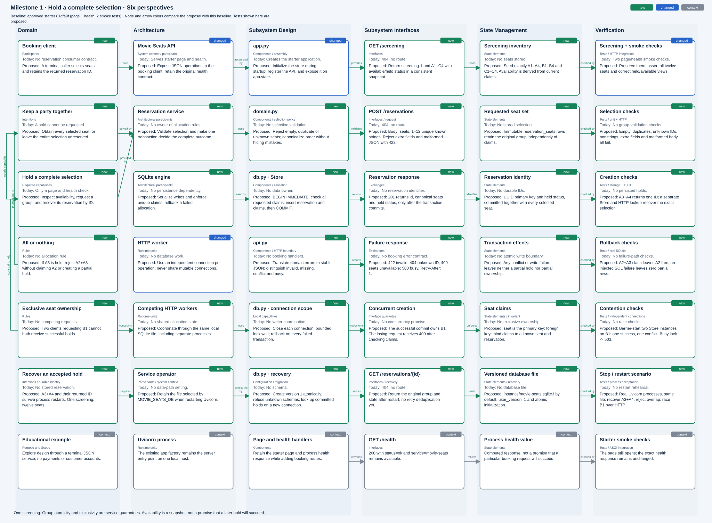
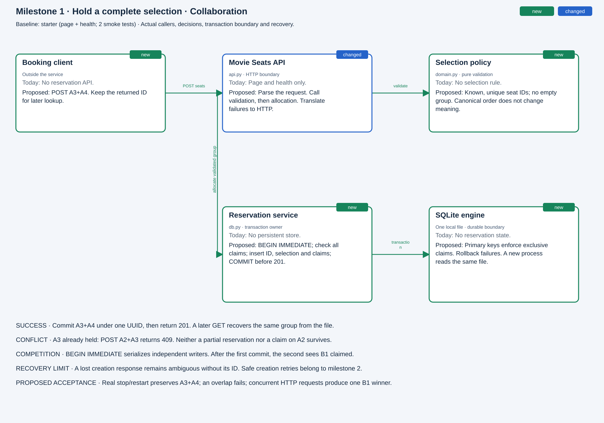
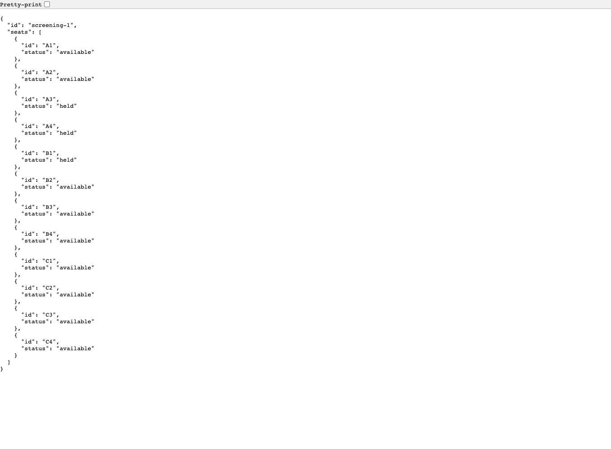
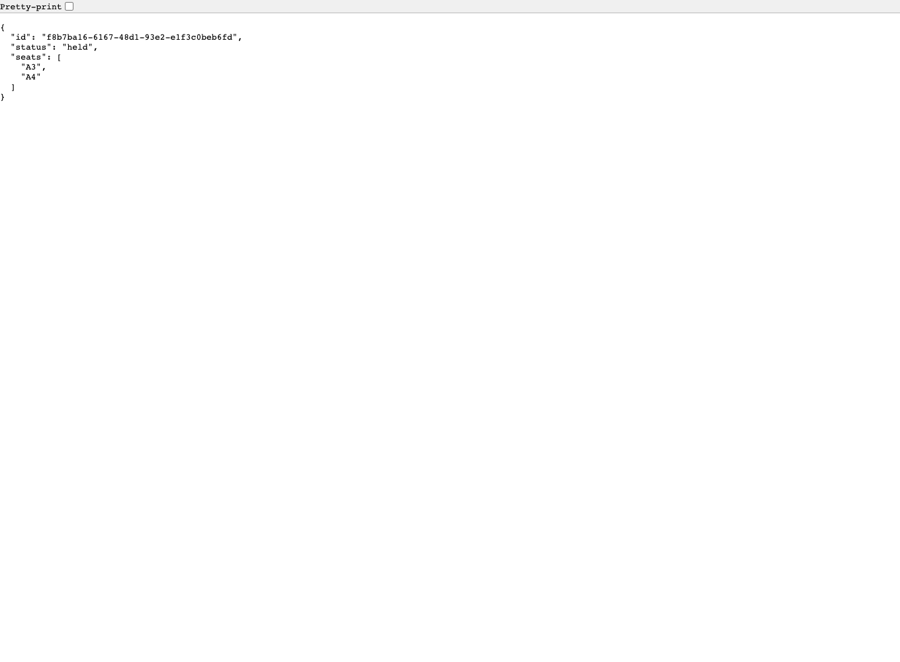

# 01 · Hold a complete selection of seats

## Prompt

```text
I’d like to build a small movie booking service called Movie Seats.
Let’s start with one screening configured with twelve seats, A1 through A4,
B1 through B4, and C1 through C4. A booking client should be able to ask
which seats are available and request a hold on one or more of them.
I’d like to use Python and FastAPI for a JSON API I can call from a terminal,
with a local SQLite database for reservations.

People booking together need their complete selection. Two clients might ask
for overlapping seats at the same time, and a caller should get either
every seat it requested or no seats at all. When a hold succeeds, I’d like
the service to return a reservation ID the caller can use to look up the
reservation, even after the service restarts.

Give me a design proposal [use $ca-design-proposal].
```

## Recorded proposal

A booking client needs to hold an entire party’s seat selection and recover the accepted reservation after a restart so that the group is never split by partial allocation.



**Milestone 1 — comparison baseline.** The approved starter `81dfa9f` serves a page and `/health`; its two smoke tests pass. There is no screening, reservation, or database. This proposal introduces those responsibilities from that source baseline. The overview connects the group’s intentions to allocation rules, responsible components, exchanges, durable facts, and distinguishing checks.



**Domain — Intentions, Required capabilities, and Rules.** A caller can inspect one screening containing A1–A4, B1–B4, and C1–C4, request one or more seats, and recover the accepted group by its reservation ID. Availability is a snapshot: another caller can win before a later request. The service accepts every requested seat or none. A3 already held means an A2+A3 request leaves A2 available. Independent callers competing for B1 cannot both succeed.

Selection spelling is exact and case-sensitive. An empty group, duplicate seat, unknown identifier, nonstring, or extra request field is invalid; the service will reject mistakes rather than silently deduplicate or reinterpret them. Sorting valid seats makes representation stable without changing selection meaning. These are proposed interface choices within the prompt’s scope. Holds have no completion or expiry behavior at this checkpoint.

**Architecture — System context and Runtime units.** A terminal client calls a FastAPI service served by Uvicorn. A reservation service owns the allocation decision; the local SQLite engine supplies transaction isolation and durable storage. Every operation opens and closes its own connection. Writers sharing a file coordinate through SQLite, including workers in different processes. This design assumes one host and a local filesystem; it does not establish multi-host database safety.

**Subsystem Design — Components.** The package is `movie_seats`.

| Package or module | Components: existing → proposed responsibility |
| --- | --- |
| `app.py` — changed | Starter assembly → initialize the configured store during startup and register booking routes; retain page and health. |
| `domain.py` — new | No selection policy → validate exact seat IDs, preserve group meaning, and define caller-visible domain failures. |
| `db.py` — new | No persistence → initialize schema version 1, allocate atomically, read consistent snapshots, and recover holds by ID. |
| `api.py` — new | No booking boundary → parse JSON, call the store, and translate domain failures into stable HTTP responses. |
| `scripts/acceptance.py` — new | No process rehearsal → exercise actual HTTP requests across independent Uvicorn processes and restarts. |

**Subsystem Interfaces — Interfaces and Exchanges.** `GET /screening` returns the twelve seats with `available` or `held` status. `POST /reservations` accepts `{"seats":["A3","A4"]}` and returns HTTP 201 with `id`, canonical `seats`, and `status: "held"`, after commit. `GET /reservations/{id}` returns that reservation or 404. Invalid requests return 422, occupied selections 409, and a bounded database lock timeout 503 with `Retry-After: 1`. The page and exact `/health` response remain compatible.

A lost creation response remains ambiguous if the caller never learned the ID. Repeating an unkeyed request is not yet safe recovery; milestone 2 supplies that capability. A successful availability read is also not a reservation promise.

**State Management — State elements and transaction boundary.** Four tables separate the fixed screening inventory, reservation identity/state, immutable requested selection, and current seat claims. A claim’s seat primary key enforces one owner; foreign keys bind it to known seats and reservations. Allocation starts `BEGIN IMMEDIATE`, checks the whole selection, writes the reservation and every claim, and commits before success is returned. Conflicts and SQL failures roll back the entire operation. Reads use one transaction for a consistent view.

`MOVIE_SEATS_DB` selects the persistent file, defaulting to `instance/movie-seats.sqlite3`. Startup creates a new version-1 database transactionally, reuses a recognized database, and refuses unrecognized or newer schemas. It never resets an existing database to make startup succeed. This checkpoint introduces no migration of historical development data.

**Verification — Tests.** The following checks will be added; they have not run yet.

| Layer and real dependency | Distinguishing observation |
| --- | --- |
| Unit, selection policy | Valid order canonicalizes; empty, duplicate, malformed and unknown selections fail. |
| Integration, actual SQLite | A3+A4 survives a new Store; A2+A3 clash leaves A2 free; injected SQL failure leaves no partial rows. |
| Integration, independent connections | A barrier-start B1 race has one winner; a held database write lock produces a bounded busy error. |
| Integration, actual ASGI app and temporary SQLite | Exact success/error contracts, twelve-seat view, and retained page/health behavior. |
| Process acceptance, HTTP and real files | Hold A3+A4, stop and restart Uvicorn, recover the same ID, reject overlap, and race two clients for B1. |

Run the suite with `uv run --locked python -m pytest -q` and the terminal scenario with `uv run --locked python scripts/acceptance.py --milestone 1`. Each scenario uses its own temporary data. Browser captures will show actual JSON responses; proposal figures remain explicitly labeled explanatory diagrams.

**Authorization.** Your standing instruction authorizes implementation after this completed proposal. I will proceed under that instruction; no separate approval message is asserted.

## Recorded implementation report

Milestone 1 is implemented in commit `edaddef6b4f46260ad0694930af343e4f2dafe11`: a client can inspect twelve seats, hold a complete selection, and recover the reservation after restarting the service.

The implementation follows the proposal’s module boundaries. `domain.py` validates selection meaning; `db.py` owns versioned SQLite state and atomic allocation; `api.py` translates requests and failures; `app.py` initializes the configured store. The original page and health contract remain intact. JSON responses are formatted for terminal and browser inspection.

**Observed verification:** `uv run --locked python -m pytest -q` passed **33 tests**. The checks include independent SQLite writers, a bounded lock timeout, rollback after an injected write failure, malformed HTTP requests, and refusal to overwrite unrecognized database files.

The real-process acceptance scenario passed: A3+A4 were recovered under the same reservation ID after stopping and restarting Uvicorn; A2+A3 returned 409 while A2 remained available; two concurrent clients using separate server processes produced exactly one 201 and one 409 for B1.

These are browser screenshots of actual service responses. The proposal’s overview and collaboration figures are explanatory diagrams, not screenshots. Structured acceptance observations and screenshot response bodies are included in the recording.

**Current limits:** there is one local screening and no authentication. A caller that loses the creation reply without learning its ID cannot yet recover it by retrying. Holds do not yet confirm, cancel, or expire. Those capabilities belong to the next two prompts.

The milestone’s implementation is committed separately from this recording. I will use this new implementation as the baseline for milestone 2 under your standing authorization.

## Working result





## Repeat the checks

To run this milestone as recorded, check out `edaddef` in a separate clone and run the following from the repository root.

```sh
uv run --locked python -m pytest -q
uv run --locked python scripts/acceptance.py --milestone 1
```

The acceptance script starts separate service processes. It checks that A3 and A4 stay together across a restart, that a conflicting request leaves A2 free, and that only one caller wins B1.

[Implementation commit](https://github.com/hirendra-rathor/example-movie-seats/commit/edaddef6b4f46260ad0694930af343e4f2dafe11) · [Original response files and acceptance data](https://github.com/hirendra-rathor/example-movie-seats/tree/439868586540107ecf56e87a7c5e156e62849667/docs/recordings/01-holds)

[Recording index](README.md)
