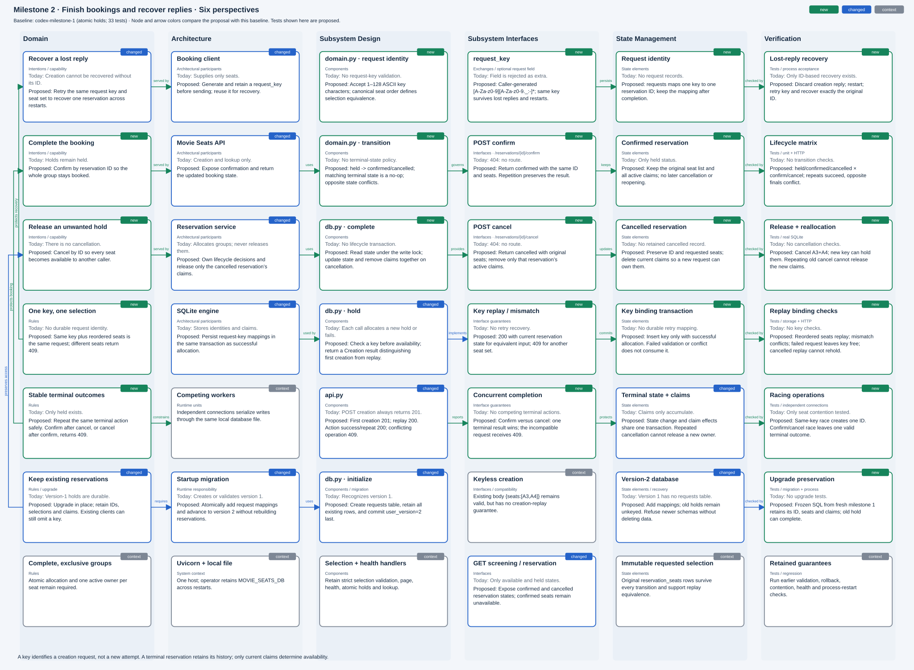
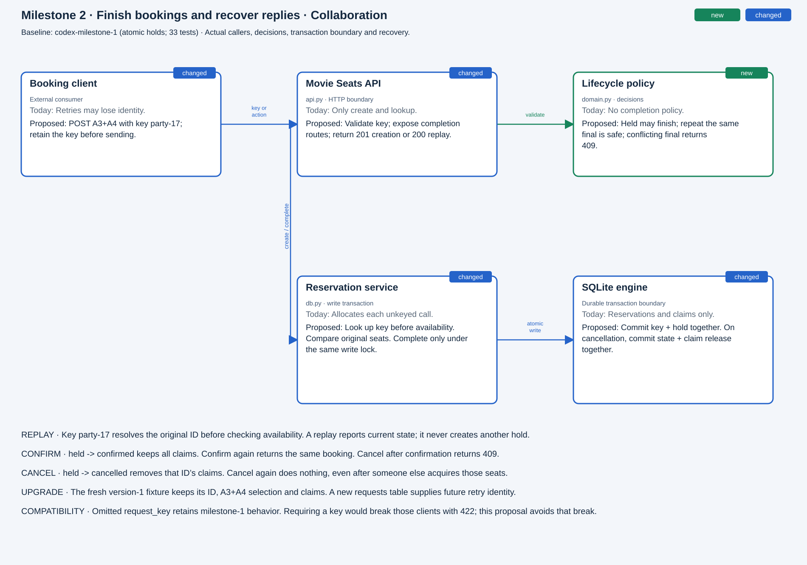
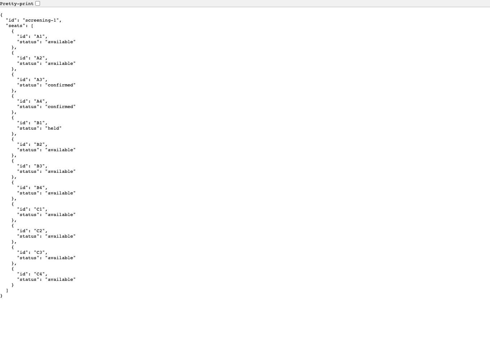
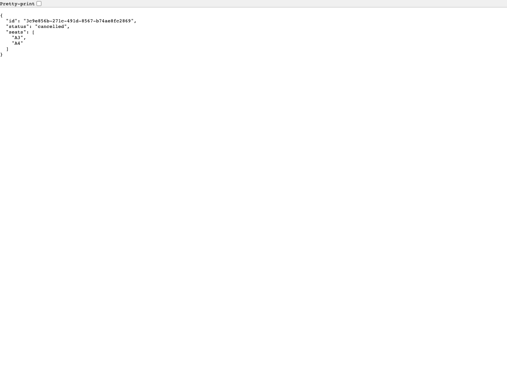

# 02 · Confirm or cancel a hold and recover a lost reply

## Prompt

```text
Movie Seats can now hold seats and return a reservation ID. I’d like a
client to be able to use that ID to confirm the booking or cancel the hold
so someone else can book the seats. This should work for holds made with
the first version too.

A client can lose the reply to a request. I’d like it to be able to retry
safely, even after the service restarts. If the lost reply was for the
original hold, the caller should be able to find out whether its seats were
held and recover the reservation ID. It should also be safe to repeat a
confirmation or cancellation.

Give me a design proposal [use $ca-design-proposal].
```

## Recorded proposal

A booking client needs to finish or release its held seats and recover a lost reply without creating another reservation or changing an already completed outcome.



**Milestone 2 — comparison baseline.** The milestone 1 implementation provides atomic holds, durable ID lookup, and 33 passing tests. Its `Store.hold` creates a new reservation for every successful unkeyed call, and every reservation remains held. Its immutable requested-seat rows and separate active claims provide the basis for safe completion and replay.



**Domain — Intentions and Required capabilities.** The caller wants to keep its group booked by confirming, release the group by cancelling, and recover creation when its reply is lost. The service will add confirmation and cancellation by ID, plus durable creation identity through a caller-generated `request_key` supplied before sending the request.

**Rules — identity and completion.** A key names one seat selection for this service. Canonical seat order makes A3+A4 and A4+A3 equivalent. Reusing the key for A2+A3 returns 409, even if those seats are available. Only successful creation consumes a key; failed validation or an unavailable group leaves the key reusable. Keys remain bound after cancellation or confirmation. Replaying a cancelled reservation returns that cancelled reservation and cannot acquire the seats again.

| Current reservation | Confirm | Cancel |
| --- | --- | --- |
| `held` | `confirmed`; keep every claim | `cancelled`; release every claim |
| `confirmed` | Return the same confirmed booking | 409; preserve the booking |
| `cancelled` | 409; preserve cancellation | Return the same cancelled reservation |

This terminal-state policy protects a completed result from a delayed conflicting request. Cancellation remains a hold operation, rather than a way to undo a confirmed booking.

**Compatibility choice.** Requiring a key would make an existing request such as `{"seats":["A3","A4"]}` fail with 422. I propose keeping the key optional: that request retains milestone-1 behavior, while `{"seats":["A3","A4"],"request_key":"party-17"}` gains replay recovery. Existing holds can complete after upgrade but cannot retroactively gain a lost creation key. No ambiguity prevents proceeding under this compatibility policy.

**Architecture — participants and transactions.** The booking client owns key generation and retention. The API validates request shape and translates results. The reservation service owns equivalence and lifecycle decisions. SQLite stores the key-to-reservation association and serializes competing creation or completion operations. Multiple workers continue to coordinate through the same local file.

**Subsystem Design — Components.** Within `movie_seats`, these changes extend the fresh implementation:

| Package or module | Components: existing → proposed responsibility |
| --- | --- |
| `domain.py` — changed | Selection rules → also validate keys, define terminal transitions, and represent creation versus replay with a `Creation` result. |
| `db.py` — changed | Allocate and look up holds → first resolve a key, compare its original selection, perform completion, and migrate version 1 to 2. |
| `api.py` — changed | Creation and lookup → accept an optional key, distinguish 201 creation from 200 replay, and expose confirm/cancel. |
| `tests/fixtures/release_v1.sql` — new | Freeze a database generated by this run’s milestone-1 code, providing an independent upgrade input. |
| `scripts/acceptance.py` — changed | Hold/restart rehearsal → also upgrade a previous hold and rehearse lost-reply recovery and repeated completion over HTTP. |

**Subsystem Interfaces — Interfaces and Exchanges.** `POST /reservations` adds optional `request_key`: 1–128 ASCII characters matching `[A-Za-z0-9][A-Za-z0-9._:-]*`. Omitted or null means unkeyed creation. First success returns 201; an equivalent keyed replay returns 200 with the same ID and current state. Returning current state lets a caller discover that another action already confirmed or cancelled the reservation.

`POST /reservations/{id}/confirm` and `/cancel` need no body and return 200 on success or repetition. Unknown IDs return 404; incompatible terminal operations and key reuse return distinct 409 error codes. Existing invalid-request and database-busy contracts remain. Screening reports confirmed seats as unavailable; cancelled reservations remain retrievable with their original seats.

**State Management — State elements and migration.** Version 2 adds a `requests` table mapping a unique key to one reservation ID. A creation transaction checks this mapping before checking availability, so the caller’s own hold cannot make its retry fail. Key insertion, reservation creation, and all seat claims commit together. Original selections remain immutable and support equivalence checks after claims are released.

Completion reads state under `BEGIN IMMEDIATE`. Confirmation updates status while retaining claims. Cancellation updates status and deletes claims for that reservation ID in the same transaction. Repeated cancellation performs no deletion, preventing it from releasing seats subsequently acquired by someone else. Concurrent confirm/cancel requests produce one terminal winner and one conflict.

Migration adds the table without rebuilding or replacing existing reservations, advances `user_version` only in the same successful transaction, and is safe to reopen. Unknown newer versions remain rejected. A migration failure preserves the prior database.

**Verification — Tests.** Proposed additions cover the complete transition matrix; key validation and reordered selection; mismatch rejection; replay after restart, confirmation, and cancellation; failed requests not consuming keys; same-key contention; concurrent confirm/cancel; and cancellation after reallocation. Real SQLite migration checks use the frozen fresh version-1 fixture and verify unchanged IDs, requested seats, and claims. Existing atomicity and HTTP checks remain.

Run `uv run --locked python -m pytest -q`. Run `uv run --locked python scripts/acceptance.py --milestone 2` to upgrade a version-1 hold, release its seats, create with a key, simulate discarding the response, restart, recover the ID, and safely repeat completion. This simulates a lost reply; it does not claim a network-fault injection. The milestone-1 scenario will also run against the evolved service.

**Authorization.** I will implement this completed proposal under your standing authorization, then capture the observed checks and actual application screenshots. No separate approval message is asserted.

## Recorded implementation report

In milestone 2, clients can confirm or cancel holds and recover keyed creation requests after a lost reply or restart.

A creation request can now include `request_key`. First creation returns 201; equivalent retries return 200 with the same reservation ID and current state. Reordered seats are equivalent. Reusing a key for different seats returns 409. Existing keyless requests remain accepted, with their original recovery limits.

Confirmation keeps every seat claimed. Cancellation preserves the reservation and original seat list while releasing its claims. Repeating the same completion is safe; attempting the opposite terminal action returns 409. Old cancellation requests and old creation keys cannot affect a newer owner of the same seats.

**Recorded verification.** At milestone 2, the complete suite passed **66 tests**. New coverage includes the transition matrix, key validation, concurrent same-key creation, confirm/cancel contention, failed-key-write rollback, failed-release rollback, and preservation of a version-1 database generated by this run. Migration failure also leaves the previous version and data intact.

The milestone-2 process scenario passed using real HTTP servers: it upgraded and cancelled a version-1 A3+A4 hold, created a keyed replacement, simulated discarding that reply, restarted, recovered the original replacement ID, confirmed it, and repeated completion safely. Concurrent same-key requests through separate server processes returned one 201 and one 200 with the same ID. The milestone-1 process scenario also passed against this implementation.

These are actual browser captures of the running API, not explanatory diagrams. The recording also includes the current screening screenshot, structured acceptance observations, and the response bodies associated with each capture.

**Current limits:** safe creation recovery requires a key supplied before the original request. The lost-reply rehearsal discards a response at the scenario level; it does not inject a network failure. Keys remain stored for the lifetime of this educational database. Holds still have no deadline, and container deployment remains for milestone 3.

I will now use this fresh implementation as the baseline for the expiration proposal under your standing authorization.

## Working result






## Repeat the checks

From the repository root on the `codex` branch, run the full test suite and the booking and retry scenario.

```sh
uv run --locked python -m pytest -q
uv run --locked python scripts/acceptance.py --milestone 2
```

The rehearsal upgrades an earlier hold, discards a keyed creation reply, restarts the service, and retrieves the same reservation. Concurrent retries must return one reservation ID.

[Recording index](README.md) · [Previous milestone](01-holds.md)
