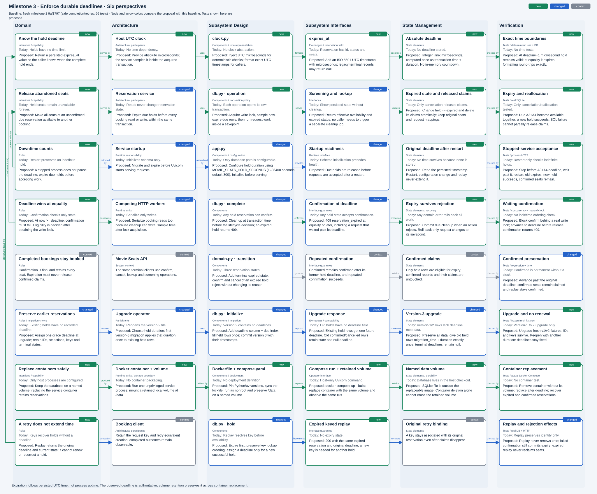
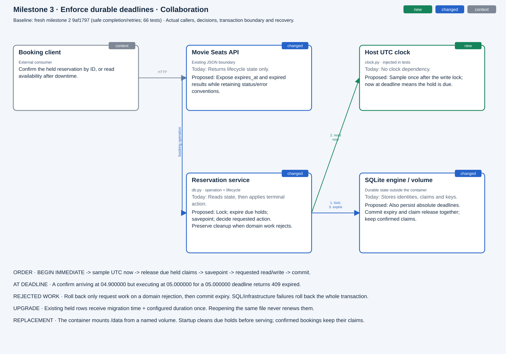
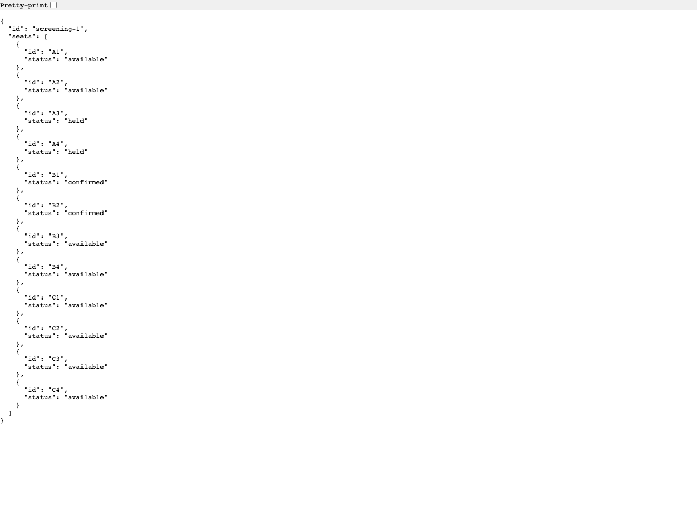
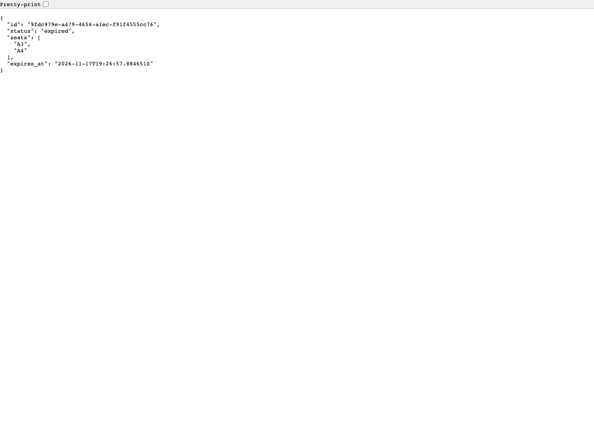
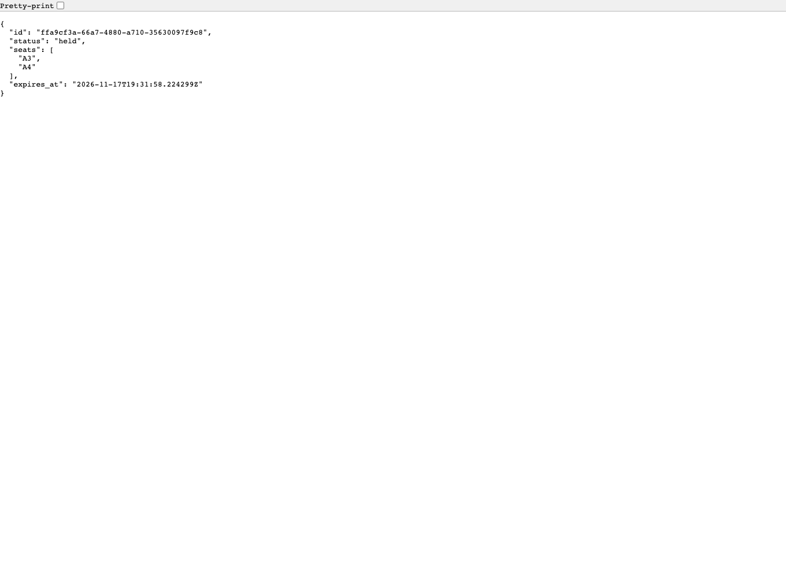

# 03 · Release abandoned holds

## Prompt

```text
Movie Seats now lets clients confirm or cancel a hold. I’d like each new
hold to have a time limit, and I’d like the service to tell the caller when
the hold expires. Once an unconfirmed hold expires, its seats should be
available for booking again. Confirmed bookings should keep their seats.

When we stop the service for maintenance or an upgrade, that downtime
should count toward the hold time. If a deadline passes while the service
is stopped, the seats should be available when it starts accepting requests
again.

Upgrading should preserve reservations made with earlier versions. I’d also
like to run the service in a container and keep those reservations when we
replace the container.

Give me a design proposal [use $ca-design-proposal].
```

## Recorded proposal

Booking clients need abandoned holds to release their seats on time, while operators need those deadlines and confirmed bookings to survive downtime, upgrades, and container replacement.



**Milestone 3 — comparison baseline.** The milestone 2 implementation has durable holds, confirmation, cancellation, keyed recovery, version-2 migration, and 66 passing tests. Its stored reservations have no deadline. `Store.get` and `screening` read without changing state, and `complete` can confirm any held reservation regardless of elapsed time. No container packaging exists.



**Domain — Intentions and Required capabilities.** A caller needs a definite deadline and eventual release of an abandoned group. A confirmed booking must retain its seats. The operator needs service downtime to count and upgrades to preserve existing reservation identity and retry mappings. This adds expiration and persistent container deployment to the current service.

**Rules — the timing boundary.** Every new hold receives an absolute deadline. At `now >= deadline`, an unconfirmed hold becomes `expired` and releases all claims. Confirmation and cancellation of an expired hold return 409 `reservation_expired`; neither reopens it or changes the recorded reason. Keyed replay returns 200 with the original ID, deadline, and current expired state. A new booking requires a new key. Confirmation completed before expiry remains final, even after its former deadline.

Eligibility is decided after acquiring the SQLite write lock. For a deadline of 12:00:05.000000, a confirmation arriving at 12:00:04.900000 but obtaining the lock at 12:00:05.000000 is too late. An arrival-time policy would accept it despite the elapsed deadline; I recommend transaction-time eligibility so competing workers agree on one serialized decision. Tests will cover the microsecond before, exact equality, and a request delayed behind a real lock.

**Upgrade choice.** Earlier holds have no original timestamp from which to reconstruct a deadline. Expiring them immediately would release A3+A4 as soon as the upgrade runs; leaving them indefinite would preserve abandoned holds forever. I propose a one-time grace deadline of migration time plus the configured duration. IDs, selections, claims, and keys survive. Previously confirmed or cancelled records keep their state and a null deadline. Reopening the database or changing duration never renews an assigned deadline.

**Architecture — participants and runtime.** The reservation service uses the host’s UTC clock and SQLite file; it does not rely on an in-memory countdown or background scheduler. Startup and every valid booking operation clean up due holds before returning state or allocating seats. Therefore a service that was stopped past a deadline exposes released seats when it becomes ready. An idle database may retain an unswept row until the next operation, but the API never relies on that stale row without applying the deadline.

This simple design acquires the write lock for booking reads as well as writes. That trades read concurrency for one clear ordering of expiry, confirmation and allocation in this small twelve-seat example. Accurate host wall time is an operating assumption; clock jumps can change when an unseen deadline is reached. Once a reservation is persisted as expired, a backward clock adjustment does not revive it.

**Subsystem Design — Components.** Within `movie_seats`, the changes are:

| Package or module | Components: existing → proposed responsibility |
| --- | --- |
| `clock.py` — new | No time abstraction → UTC integer microseconds and exact response formatting, with an injectable clock for tests. |
| `db.py` — changed | State-only operations → common expiry-aware transaction, one-time deadlines, persisted expiration, and version-3 migration. |
| `domain.py` — changed | Three-state completion policy → add terminal expired rejection while retaining confirmed/cancelled rules. |
| `app.py` — changed | Database-path configuration → also validate hold duration and initialize/migrate/expire before accepting requests. |
| `Dockerfile`, `compose.yaml`, `.dockerignore` — new | Host-only execution → locked runtime, nonroot service, localhost port, and a named data volume. |
| Tests and acceptance scripts — changed/new | Completion/retry checks → deterministic timing, upgrades from this run’s frozen v1/v2 data, process downtime and actual container replacement. |

**Subsystem Interfaces — Exchanges and controls.** Reservation responses add `expires_at`, an ISO 8601 UTC timestamp with microseconds, or null for legacy terminal records. Existing endpoints and request-key rules remain. `MOVIE_SEATS_HOLD_SECONDS` selects an integer from 1 to 86400, default 300; invalid values stop startup clearly. The setting affects new holds and the first upgrade grace period, never existing deadlines.

`docker compose up --build` runs the service with its SQLite file under `/data` on a named volume. The image will use the repository’s Python version, a pinned uv version, and `uv sync --locked --no-dev`. The existing host Uvicorn workflow remains supported. Replacing the container preserves the volume; deleting that volume intentionally deletes its database.

**State Management — atomic effects and failure.** Version 3 adds integer `expires_at_us` and a due-hold index. Within `BEGIN IMMEDIATE`, the service samples time once and atomically changes due held rows to expired while deleting only their claims. It then creates a savepoint for the requested action. A domain rejection rolls back action work but commits due cleanup; thus a rejected late confirmation still leaves a durable expired record. SQL or infrastructure failures roll back the entire transaction. IDs, requested selections, and request mappings are retained throughout.

**Verification — Tests.** Deterministic tests will check deadline equality, no renewal on replay/restart/configuration change, retained confirmed claims, persisted expiry after rejected work, rollback on failed release, and lock-wait ordering. Frozen databases from the two fresh implementation commits will verify migration, grace assignment, terminal-state preservation and failure rollback. Existing tests and the earlier process scenarios remain part of regression verification.

Run `uv run --locked python -m pytest -q` and `uv run --locked python scripts/acceptance.py --milestone 3`. The real-process scenario will stop before the deadline, restart after it, recover the expired ID, reallocate A3+A4 and preserve a confirmed group. `uv run --locked python scripts/container_acceptance.py` will build the actual image, remove a container while keeping its named volume, replace it after the deadline, verify both outcomes, and clean up only its isolated test resources. Docker Desktop is available for that check.

**Authorization.** I will implement these explicit timing and upgrade policies under your standing authorization, then capture actual results and screenshots before creating the separate recording commit.

## Recorded implementation report

In milestone 3, holds have persisted deadlines, expire across downtime, and survive container replacement through a retained data volume.

The implementation uses absolute UTC microseconds and evaluates time after acquiring SQLite’s write lock. At the deadline, a held reservation expires and releases its complete selection. Confirmed bookings retain their claims. Creation retries retain the original deadline and cannot renew or resurrect an expired hold.

Version-1 and version-2 databases produced by this run upgrade in place. Existing held reservations receive one grace deadline at migration time; confirmed and cancelled legacy records keep their state and a null deadline. Reopening the file or changing duration does not reset assigned deadlines. Due cleanup commits even when a subsequent domain operation rejects, while SQL failures roll back the transaction.

**Recorded verification.** At milestone 3, the full suite passed **94 tests**. New checks cover exact microsecond boundaries, a confirmation waiting behind a real database lock, expiry after restart, no renewal on replay, preservation of confirmed claims, rollback during failed cleanup, migration rollback, and configuration validation. Both earlier process acceptance scenarios also passed against this implementation.

The milestone-3 process scenario stopped before an A3+A4 deadline and restarted after it. The original ID reported expired, confirmation returned 409, keyed replay recovered that expired result, and another request successfully held A3+A4. The confirmed B1+B2 reservation retained its seats.

The actual Docker Compose scenario also passed. It built the locked image, ran the service as UID 10001, removed the first container while keeping its named volume, and created a different container using that same volume after the deadline. The expired reservation, confirmed booking, and request-key mappings survived; A3+A4 could be held again. The script removed only its isolated project, test volume, and local image tag afterward.

**Operating limits:** this remains an educational, single-host SQLite service. Booking reads acquire the write lock because they may expire holds. Correct deadline timing depends on the host’s UTC clock. Cleanup occurs at startup and booking operations, without a background scheduler. Request-key records are retained. The container’s Python and uv image tags pin versions, but are not immutable digest pins; the tested application image ID is recorded with the container result.

## Working result








## Repeat the checks

From the repository root on the `codex` branch, run the full test suite and the expiration and container-replacement scenarios. The container check uses Docker Compose.

```sh
uv run --locked python -m pytest -q
uv run --locked python scripts/acceptance.py --milestone 3
uv run --locked python scripts/container_acceptance.py
```

The process rehearsal restarts the service after a deadline. The Docker check replaces the container on the same volume and verifies that the expired seats can be held again while the confirmed booking survives.

[Recording index](README.md) · [Previous milestone](02-booking.md)
