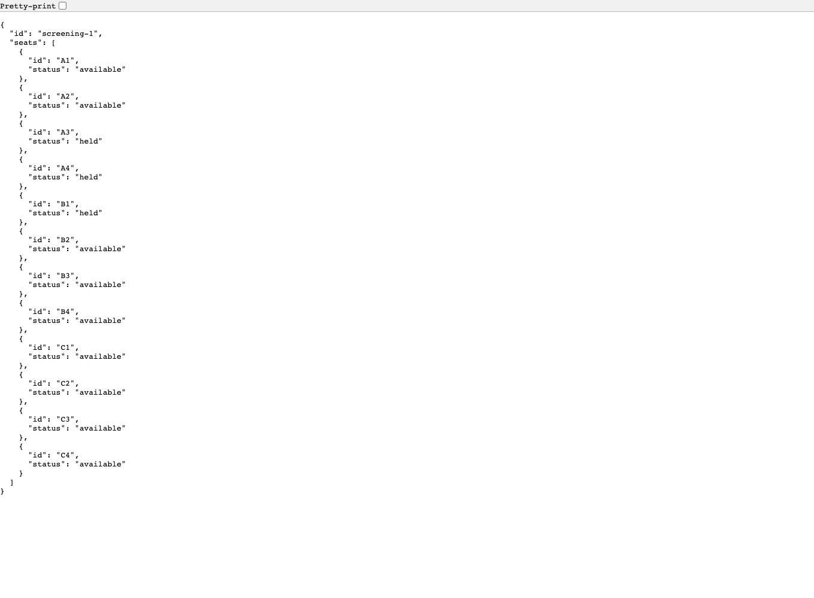
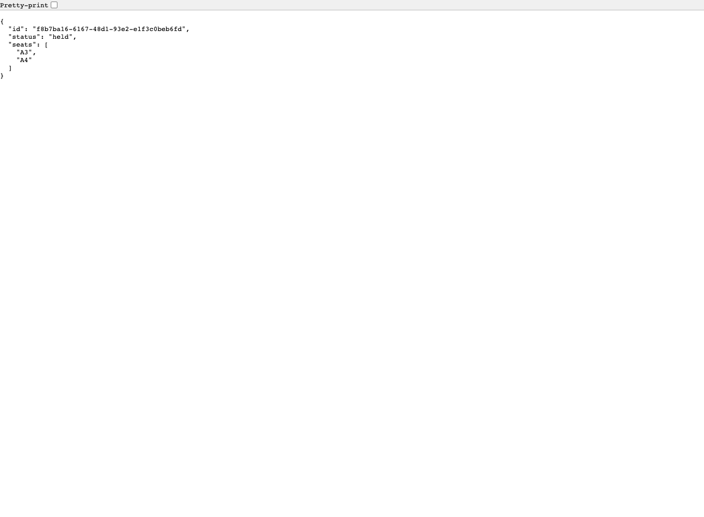

Milestone 1 is implemented in commit `edaddef6b4f46260ad0694930af343e4f2dafe11`: a client can inspect twelve seats, hold a complete selection, and recover the reservation after restarting the service.

The implementation follows the proposal’s module boundaries. `domain.py` validates selection meaning; `db.py` owns versioned SQLite state and atomic allocation; `api.py` translates requests and failures; `app.py` initializes the configured store. The original page and health contract remain intact. JSON responses are formatted for terminal and browser inspection.

**Observed verification:** `uv run --locked python -m pytest -q` passed **33 tests**. The checks include independent SQLite writers, a bounded lock timeout, rollback after an injected write failure, malformed HTTP requests, and refusal to overwrite unrecognized database files.

The real-process acceptance scenario passed: A3+A4 were recovered under the same reservation ID after stopping and restarting Uvicorn; A2+A3 returned 409 while A2 remained available; two concurrent clients using separate server processes produced exactly one 201 and one 409 for B1.

These are browser screenshots of actual service responses. The proposal’s overview and collaboration figures are explanatory diagrams, not screenshots. Structured acceptance observations and screenshot response bodies are included in the recording.

**Current limits:** there is one local screening and no authentication. A caller that loses the creation reply without learning its ID cannot yet recover it by retrying. Holds do not yet confirm, cancel, or expire. Those capabilities belong to the next two prompts.

The milestone’s implementation is committed separately from this recording. I will use this new implementation as the baseline for milestone 2 under your standing authorization.
