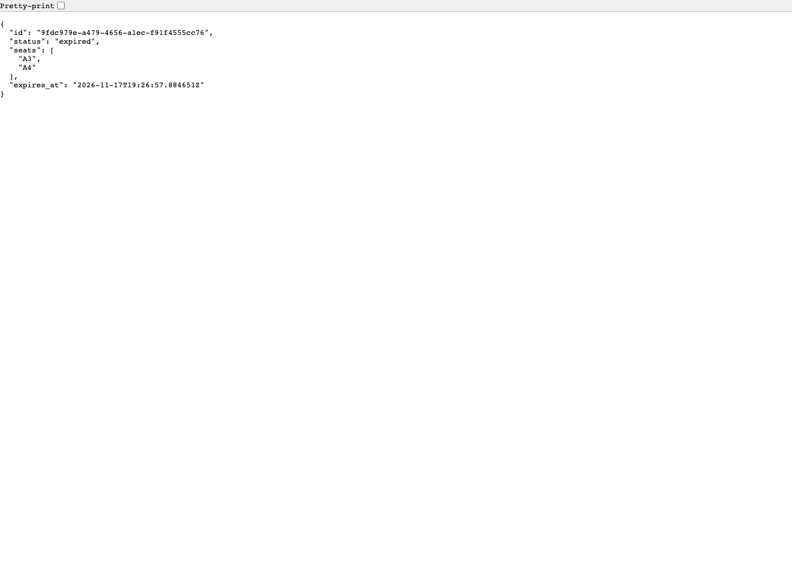

Milestone 3 is implemented in commit `0e994e4e7c1220ea5568f68b32fe685abf4adb78`: holds now have persisted deadlines, expire across downtime, and survive container replacement through a retained data volume.

The implementation uses absolute UTC microseconds and evaluates time after acquiring SQLite’s write lock. At the deadline, a held reservation expires and releases its complete selection. Confirmed bookings retain their claims. Creation retries retain the original deadline and cannot renew or resurrect an expired hold.

Version-1 and version-2 databases produced by this run upgrade in place. Existing held reservations receive one grace deadline at migration time; confirmed and cancelled legacy records keep their state and a null deadline. Reopening the file or changing duration does not reset assigned deadlines. Due cleanup commits even when a subsequent domain operation rejects, while SQL failures roll back the transaction.

**Observed verification:** the full suite passed **94 tests**. New checks cover exact microsecond boundaries, a confirmation waiting behind a real database lock, expiry after restart, no renewal on replay, preservation of confirmed claims, rollback during failed cleanup, migration rollback, and configuration validation. Both earlier process acceptance scenarios also passed against this implementation.

The milestone-3 process scenario stopped before an A3+A4 deadline and restarted after it. The original ID reported expired, confirmation returned 409, keyed replay recovered that expired result, and another request successfully held A3+A4. The confirmed B1+B2 reservation retained its seats.

The actual Docker Compose scenario also passed. It built the locked image, ran the service as UID 10001, removed the first container while keeping its named volume, and created a different container using that same volume after the deadline. The expired reservation, confirmed booking, and request-key mappings survived; A3+A4 could be held again. The script removed only its isolated project, test volume, and local image tag afterward.

**Operating limits:** this remains an educational, single-host SQLite service. Booking reads acquire the write lock because they may expire holds. Correct deadline timing depends on the host’s UTC clock. Cleanup occurs at startup and booking operations, without a background scheduler. Request-key records are retained. The container’s Python and uv image tags pin versions, but are not immutable digest pins; the tested application image ID is recorded with the container result.

The three implementation milestones are complete. I will now create the initial offline HTML walkthrough and concise README navigation as the eighth commit, preserving the first seven commits and keeping all new work local.
