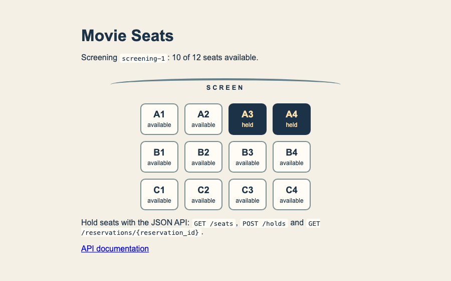
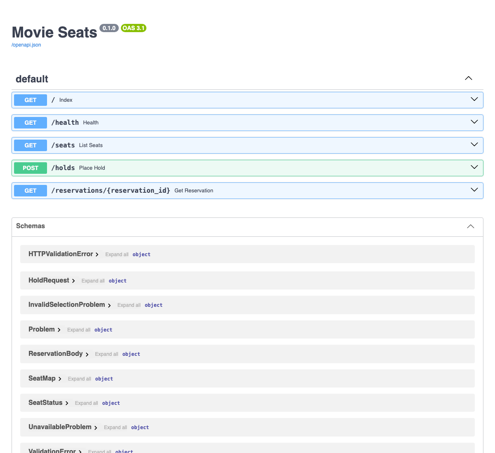

# Milestone 1: Hold a complete selection of seats

[All chapters](../README.md) · Next: [Milestone 2](../milestone-2/README.md)

**Checkpoint.** Implementation commit
[`5bcba37`](https://github.com/hirendra-rathor/example-movie-seats/commit/5bcba370df64f4a8f06761b2f77cafd3460e542c)
(`5bcba370df64f4a8f06761b2f77cafd3460e542c`) on `claude`. Browse the
[code at this checkpoint](https://github.com/hirendra-rathor/example-movie-seats/tree/5bcba370df64f4a8f06761b2f77cafd3460e542c).

*Editorial.* The first milestone turns the starter's placeholder service into a seat-holding API.
A booking client lists the twelve seats, holds a selection all or nothing, and looks the hold
up by reservation ID after a restart. The decisive case is two clients asking for overlapping
seats at the same time.

## Prompt

The first prompt from the [build guide](../../build-prompts.md), exactly as written there:

```text
I’d like to build a small movie booking service called Movie Seats.
Let’s start with one screening configured with twelve seats, A1 through A4,
B1 through B4, and C1 through C4. A booking client should be able to ask
which seats are available and request a hold on one or more of them.
I’d like to use Python and FastAPI for a JSON API I can call from a terminal,
with a local SQLite database for reservations.

People booking together need their complete selection. Two clients might ask
for overlapping seats at the same time, and a caller should get either
every seat it requested or no seats at all. When a hold succeeds, I’d like
the service to return a reservation ID the caller can use to look up the
reservation, even after the service restarts.

Give me a design proposal [use $ca-design-proposal].
```

*Editorial note.* The bracketed `[use $ca-design-proposal]` is the guide's Codex spelling of the
skill reference. Claude Code invoked the Design Proposal skill (`ca-design-proposal`) through its
skill tool with the argument `Milestone 1 of docs/build-prompts.md: Hold a complete selection of
seats`, and the proposal answers the prompt above.

## Proposal

The [recorded proposal](proposal.md) compares the design with the starter, explains each
affected perspective and closes with three decisions. It embeds two figures:

| Figure | Rendered image | Editable source |
| --- | --- | --- |
| Overview in six perspective columns | [proposal-overview.png](figures/proposal-overview.png) | [proposal-overview.svg](figures/proposal-overview.svg) |
| Collaboration: how two overlapping holds are decided | [proposal-collaboration.png](figures/proposal-collaboration.png) | [proposal-collaboration.svg](figures/proposal-collaboration.svg) |

*Editorial summary of the decisions.* Seat labels must match exactly (`a3` is rejected), a 409
names the unavailable seats, and the database lives at `instance/movie-seats.sqlite3` unless
`MOVIE_SEATS_DATABASE` names another file.

## Authorization to implement

*Editorial.* The developer's task instruction gave standing authorization to proceed from each
completed proposal to implementation without a separate approval. The proposal said so in its
closing paragraph, and Claude Code implemented it with the recommended choices. No separate
approval message was sent, and none is recorded here.

## Implementation report

The [recorded implementation report](implementation-report.md) lists the changed modules, the
verification run and the limitations. In short: 26 tests passed, the race checks passed in 15
repeated runs, and the live rehearsal below matched the proposal.

## Acceptance rehearsal

*Editorial.* The server ran in the background with the README command,
`uv run --locked uvicorn movie_seats.app:create_app --factory --host 127.0.0.1 --port 8000`, on
a fresh default database. The commands below ran from a scratch folder; the two holds were sent
by two `curl` processes started together.

*Recorded terminal output, before the restart:*

```console
$ curl -s http://127.0.0.1:8000/seats | python3 -m json.tool --compact
{"screening_id":"screening-1","seats":[{"seat":"A1","status":"available"},{"seat":"A2","status":"available"},{"seat":"A3","status":"available"},{"seat":"A4","status":"available"},{"seat":"B1","status":"available"},{"seat":"B2","status":"available"},{"seat":"B3","status":"available"},{"seat":"B4","status":"available"},{"seat":"C1","status":"available"},{"seat":"C2","status":"available"},{"seat":"C3","status":"available"},{"seat":"C4","status":"available"}]}

$ (curl -s -w ' HTTP %{http_code}\n' -X POST http://127.0.0.1:8000/holds -H 'Content-Type: application/json' -d '{"seats": ["A3", "A4"]}' > one.out &
 curl -s -w ' HTTP %{http_code}\n' -X POST http://127.0.0.1:8000/holds -H 'Content-Type: application/json' -d '{"seats": ["A4", "B1"]}' > two.out &
 wait); cat one.out two.out
{"reservation_id":"c2bb69ce-b48d-4e7c-afd8-19266549b01a","screening_id":"screening-1","status":"held","seats":["A3","A4"],"created_at":"2026-11-17T19:20:43Z"} HTTP 201
{"detail":"Some requested seats are not available.","unavailable_seats":["A4"]} HTTP 409

# The 201 reply's reservation ID: c2bb69ce-b48d-4e7c-afd8-19266549b01a

$ curl -s http://127.0.0.1:8000/seats | python3 -c 'import json,sys; print({s["seat"]: s["status"] for s in json.load(sys.stdin)["seats"] if s["status"] != "available"})'
{'A3': 'held', 'A4': 'held'}

$ curl -s -i http://127.0.0.1:8000/reservations/c2bb69ce-b48d-4e7c-afd8-19266549b01a | sed -n '1p;/^location/Ip;$p'
HTTP/1.1 200 OK
{"reservation_id":"c2bb69ce-b48d-4e7c-afd8-19266549b01a","screening_id":"screening-1","status":"held","seats":["A3","A4"],"created_at":"2026-11-17T19:20:43Z"}
$ curl -s -w ' HTTP %{http_code}\n' -X POST http://127.0.0.1:8000/holds -H 'Content-Type: application/json' -d '{"seats": ["a3"]}'
{"detail":"Unknown seats: a3.","invalid_seats":["a3"]} HTTP 422

$ curl -s -w ' HTTP %{http_code}\n' -X POST http://127.0.0.1:8000/holds -H 'Content-Type: application/json' -d '{"seats": ["B1", "B1"]}'
{"detail":"Each seat may be requested once: B1.","invalid_seats":["B1"]} HTTP 422

$ curl -s -w ' HTTP %{http_code}\n' http://127.0.0.1:8000/reservations/not-a-reservation
{"detail":"Reservation not found."} HTTP 404
```

*Editorial.* uvicorn was then stopped and started again with the same command and database file.

*Recorded terminal output, after the restart:*

```console
$ curl -s -w ' HTTP %{http_code}\n' http://127.0.0.1:8000/reservations/c2bb69ce-b48d-4e7c-afd8-19266549b01a
{"reservation_id":"c2bb69ce-b48d-4e7c-afd8-19266549b01a","screening_id":"screening-1","status":"held","seats":["A3","A4"],"created_at":"2026-11-17T19:20:43Z"} HTTP 200

$ curl -s http://127.0.0.1:8000/seats | python3 -c 'import json,sys; print({s["seat"]: s["status"] for s in json.load(sys.stdin)["seats"] if s["status"] != "available"})'
{'A3': 'held', 'A4': 'held'}
```

| Acceptance check | Observed |
| --- | --- |
| Twelve seats listed as available | Yes, A1 through C4 in layout order |
| Overlapping holds sent together | A3, A4: 201 with a reservation ID; A4, B1: 409 naming A4 |
| No partial hold | Only A3 and A4 held; B1 still available |
| Invalid selections | `a3` and a repeated `B1`: 422; unknown ID: 404 |
| Lookup after restart | 200 with the identical reservation; A3 and A4 still held |

## Screenshots

*Editorial.* These are screenshots of the running service captured with headless Chrome during
the rehearsal. They are not design diagrams.



*The entry page's seat map right after the overlapping holds: A3 and A4 are held.*


*The same seat map after uvicorn was restarted on the same database file.*



*The API documentation page at `/docs`, listing the new endpoints and their schemas.*
