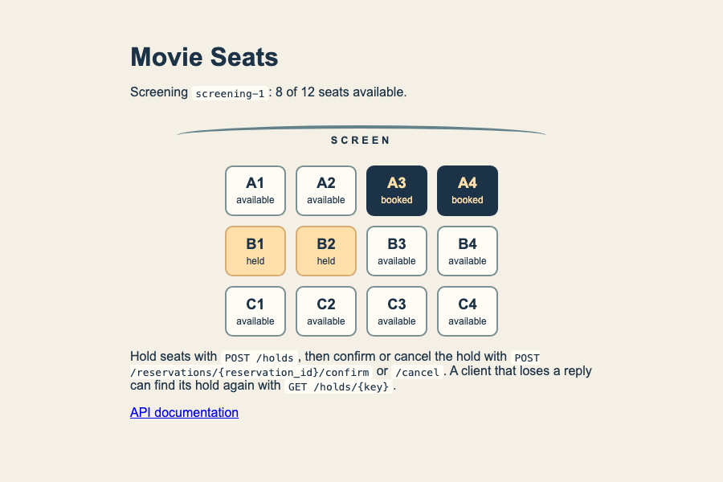
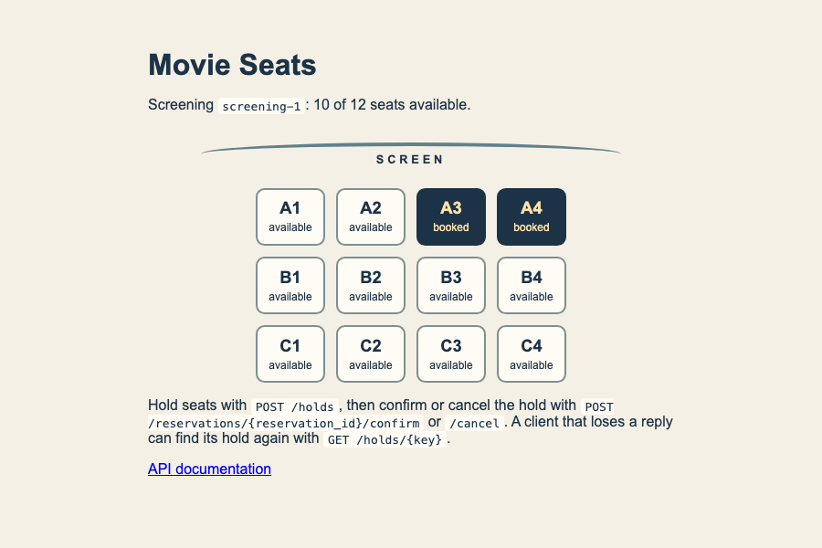
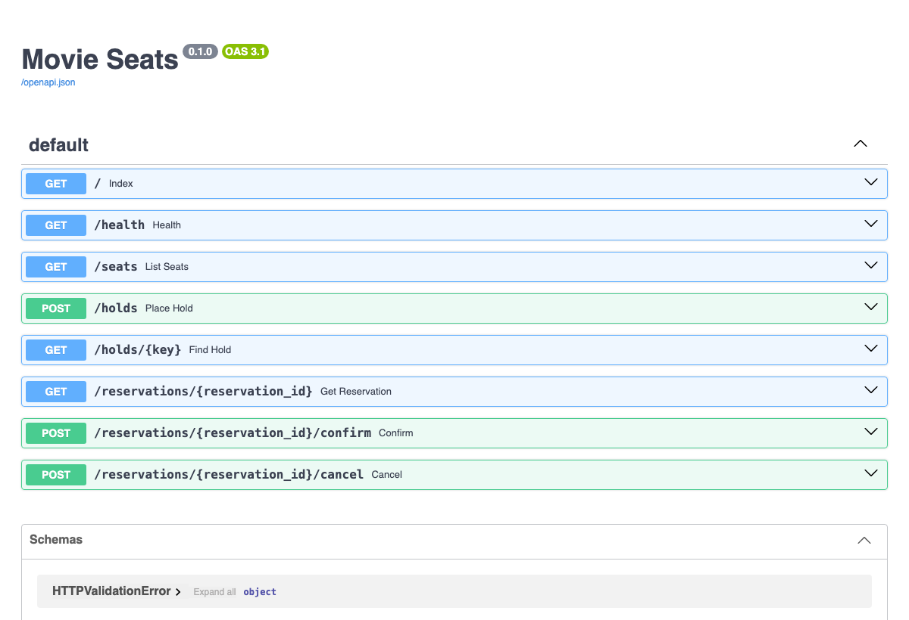

# Milestone 2: Confirm or cancel a hold and recover a lost reply

[All chapters](../README.md) · Previous: [Milestone 1](../milestone-1/README.md) · Next: [Milestone 3](../milestone-3/README.md)

**Checkpoint.** Implementation commit
[`bcc365b`](https://github.com/hirendra-rathor/example-movie-seats/commit/bcc365bda6609b11d87fe2aa7c5f0026bca28a76)
(`bcc365bda6609b11d87fe2aa7c5f0026bca28a76`) on `claude`. Browse the
[code at this checkpoint](https://github.com/hirendra-rathor/example-movie-seats/tree/bcc365bda6609b11d87fe2aa7c5f0026bca28a76).

*Editorial.* The second milestone lets a client settle a hold, by confirming or cancelling it,
and recover when a reply goes missing. The decisive cases are a hold whose 201 never reaches
the client, retried after a restart, and a hold made by the milestone 1 build that must still
be confirmable after the upgrade.

## Prompt

The [second build prompt](../../build-prompts.md#2-confirm-or-cancel-a-hold-and-recover-a-lost-reply) is shown here with Claude Code’s skill command.

```text
Movie Seats can now hold seats and return a reservation ID. I’d like a
client to be able to use that ID to confirm the booking or cancel the hold
so someone else can book the seats. This should work for holds made with
the first version too.

A client can lose the reply to a request. I’d like it to be able to retry
safely, even after the service restarts. If the lost reply was for the
original hold, the caller should be able to find out whether its seats were
held and recover the reservation ID. It should also be safe to repeat a
confirmation or cancellation.

Give me a design proposal [use /ca-design-proposal].
```

*Editorial note.* Claude Code invoked the Design Proposal skill (`ca-design-proposal`) through
its skill tool with the argument `Milestone 2 of docs/build-prompts.md: Confirm or cancel a hold
and recover a lost reply`, and the proposal answers the prompt above. The comparison baseline
was the milestone 1 implementation commit `5bcba37`.

## Proposal

The [recorded proposal](proposal.md) compares the design with milestone 1, gives the status
transition table and closes with three decisions. It embeds two figures:

| Figure | Rendered image | Editable source |
| --- | --- | --- |
| Overview in six perspective columns | [proposal-overview.png](figures/proposal-overview.png) | [proposal-overview.svg](figures/proposal-overview.svg) |
| Collaboration: recovering a lost hold reply and repeating a confirmation | [proposal-collaboration.png](figures/proposal-collaboration.png) | [proposal-collaboration.svg](figures/proposal-collaboration.svg) |

*Editorial summary of the decisions.* The `Idempotency-Key` header is optional so milestone 1
callers keep working, only successful holds are recorded under a key, and a confirmed booking
can't be cancelled (409).

## Authorization to implement

*Editorial.* The developer's task instruction gave standing authorization to proceed from each
completed proposal to implementation without a separate approval. The proposal said so in its
closing paragraph, and Claude Code implemented it with the recommended choices. No separate
approval message was sent, and none is recorded here.

## Implementation report

The [recorded implementation report](implementation-report.md) lists the changed modules, the
verification run and the limitations. In short: 58 tests passed, the race checks passed in 10
repeated runs, and the rehearsal below upgraded the real milestone 1 database.

## Acceptance rehearsal

*Editorial.* This rehearsal reused the database file left by the milestone 1 rehearsal,
`instance/movie-seats.sqlite3`, which still held A3 and A4 under reservation
`c2bb69ce-b48d-4e7c-afd8-19266549b01a`. Commands ran from the repository root.

*Recorded terminal output, before the milestone 2 build started:*

```console
$ sqlite3 instance/movie-seats.sqlite3 'PRAGMA user_version; SELECT reservation_id, status FROM reservations;'
1
c2bb69ce-b48d-4e7c-afd8-19266549b01a|held
```

*Editorial.* The milestone 2 build then started in the background with the README command,
`uv run --locked uvicorn movie_seats.app:create_app --factory --host 127.0.0.1 --port 8000`.

*Recorded terminal output, first run of the milestone 2 build:*

```console
$ sqlite3 instance/movie-seats.sqlite3 'PRAGMA user_version;'
2

$ curl -s -w ' HTTP %{http_code}\n' http://127.0.0.1:8000/reservations/c2bb69ce-b48d-4e7c-afd8-19266549b01a
{"reservation_id":"c2bb69ce-b48d-4e7c-afd8-19266549b01a","screening_id":"screening-1","status":"held","seats":["A3","A4"],"created_at":"2026-11-17T19:20:43Z"} HTTP 200

$ curl -s -w ' HTTP %{http_code}\n' -X POST http://127.0.0.1:8000/reservations/c2bb69ce-b48d-4e7c-afd8-19266549b01a/confirm
{"reservation_id":"c2bb69ce-b48d-4e7c-afd8-19266549b01a","screening_id":"screening-1","status":"confirmed","seats":["A3","A4"],"created_at":"2026-11-17T19:20:43Z"} HTTP 200

$ curl -s -w ' HTTP %{http_code}\n' -X POST http://127.0.0.1:8000/reservations/c2bb69ce-b48d-4e7c-afd8-19266549b01a/confirm
{"reservation_id":"c2bb69ce-b48d-4e7c-afd8-19266549b01a","screening_id":"screening-1","status":"confirmed","seats":["A3","A4"],"created_at":"2026-11-17T19:20:43Z"} HTTP 200

$ K=4b9d2e81-60fd-4c75-bd37-56b464efd309

$ curl -s -o /dev/null -X POST http://127.0.0.1:8000/holds -H 'Content-Type: application/json' -H "Idempotency-Key: $K" -d '{"seats": ["B1", "B2"]}'   # reply discarded

$ curl -s http://127.0.0.1:8000/seats | python3 -c 'import json,sys; print({s["seat"]: s["status"] for s in json.load(sys.stdin)["seats"] if s["status"] != "available"})'
{'A3': 'booked', 'A4': 'booked', 'B1': 'held', 'B2': 'held'}
```

*Editorial.* uvicorn was stopped and started again with the same command and database file.
The client still had only its key, `K`.

*Recorded terminal output, after the restart:*

```console
$ K=4b9d2e81-60fd-4c75-bd37-56b464efd309

$ curl -s -w ' HTTP %{http_code}\n' http://127.0.0.1:8000/holds/$K
{"reservation_id":"eef506c4-e829-43ba-afc9-0f32d5d93c38","screening_id":"screening-1","status":"held","seats":["B1","B2"],"created_at":"2026-11-17T19:34:48Z"} HTTP 200

$ curl -s -w ' HTTP %{http_code}\n' -X POST http://127.0.0.1:8000/holds -H 'Content-Type: application/json' -H "Idempotency-Key: $K" -d '{"seats": ["B2", "B1"]}'
{"reservation_id":"eef506c4-e829-43ba-afc9-0f32d5d93c38","screening_id":"screening-1","status":"held","seats":["B1","B2"],"created_at":"2026-11-17T19:34:48Z"} HTTP 200

$ curl -s -w ' HTTP %{http_code}\n' -X POST http://127.0.0.1:8000/holds -H 'Content-Type: application/json' -H "Idempotency-Key: $K" -d '{"seats": ["B1"]}'
{"detail":"This Idempotency-Key was already used for a different selection."} HTTP 422

$ H=eef506c4-e829-43ba-afc9-0f32d5d93c38

$ curl -s -w ' HTTP %{http_code}\n' -X POST http://127.0.0.1:8000/reservations/$H/cancel
{"reservation_id":"eef506c4-e829-43ba-afc9-0f32d5d93c38","screening_id":"screening-1","status":"cancelled","seats":["B1","B2"],"created_at":"2026-11-17T19:34:48Z"} HTTP 200

$ curl -s -w ' HTTP %{http_code}\n' -X POST http://127.0.0.1:8000/reservations/$H/cancel
{"reservation_id":"eef506c4-e829-43ba-afc9-0f32d5d93c38","screening_id":"screening-1","status":"cancelled","seats":["B1","B2"],"created_at":"2026-11-17T19:34:48Z"} HTTP 200

$ curl -s -w ' HTTP %{http_code}\n' -X POST http://127.0.0.1:8000/reservations/$H/confirm
{"detail":"This reservation is cancelled; it can't be confirmed.","status":"cancelled"} HTTP 409

$ curl -s -w ' HTTP %{http_code}\n' -X POST http://127.0.0.1:8000/reservations/c2bb69ce-b48d-4e7c-afd8-19266549b01a/cancel
{"detail":"This reservation is confirmed; it can't be cancelled.","status":"confirmed"} HTTP 409

$ curl -s -w ' HTTP %{http_code}\n' http://127.0.0.1:8000/holds/never-used-key
{"detail":"No hold was recorded under this key."} HTTP 404

$ curl -s http://127.0.0.1:8000/seats | python3 -c 'import json,sys; print({s["seat"]: s["status"] for s in json.load(sys.stdin)["seats"] if s["status"] != "available"})'
{'A3': 'booked', 'A4': 'booked'}
```

| Acceptance check | Observed |
| --- | --- |
| Upgrade keeps milestone 1 holds | Schema version 1 → 2; reservation `c2bb69ce-…` still held A3 and A4 |
| Confirm a milestone 1 hold, twice | 200 `confirmed` both times; A3 and A4 booked |
| Recover a lost hold reply after a restart | `GET /holds/K` returned reservation `eef506c4-…` |
| Retry the hold with the same key | 200 with the same reservation, seats given in another order |
| Key reused for other seats | 422 |
| Cancel twice, then confirm | 200, 200, then 409; B1 and B2 available again |
| Cancel a confirmed booking | 409 |
| Unused key | 404 |

## Screenshots

*Editorial.* These are screenshots of the running service captured with headless Chrome during
the rehearsal. They are not design diagrams.



*After the upgrade: the milestone 1 hold on A3 and A4 is confirmed, and the hold whose reply was
discarded holds B1 and B2.*



*After the restart and the cancellation: B1 and B2 are available again; the confirmed booking
keeps A3 and A4.*



*The API documentation page at `/docs` with the milestone 2 endpoints.*
