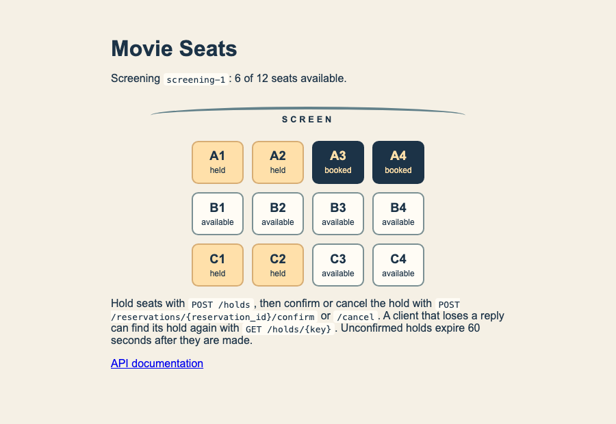
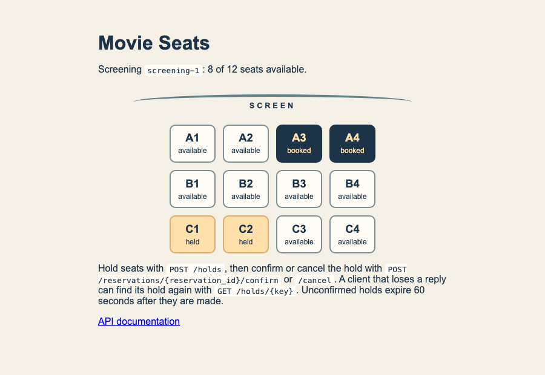
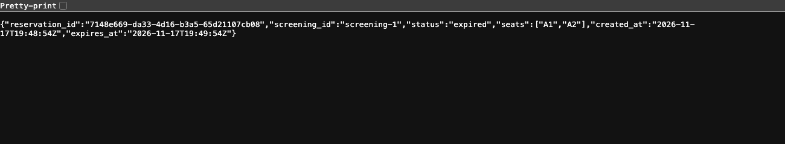

# Milestone 3: Release abandoned holds

[All chapters](../README.md) · Previous: [Milestone 2](../milestone-2/README.md)

**Checkpoint.** Implementation commit
[`5bed9eb`](https://github.com/hirendra-rathor/example-movie-seats/commit/5bed9ebbf12706659ff95e1bb3af6055b6b0b517)
(`5bed9ebbf12706659ff95e1bb3af6055b6b0b517`) on `claude`. Browse the
[code at this checkpoint](https://github.com/hirendra-rathor/example-movie-seats/tree/5bed9ebbf12706659ff95e1bb3af6055b6b0b517).

*Editorial.* The third milestone gives every hold a deadline and runs the service in a
container. The decisive cases are a deadline that passes while no container is running, and a
hold made by the previous build that must survive the upgrade and then expire on its own.

## Prompt

The [third build prompt](../../build-prompts.md#3-release-abandoned-holds) is shown here with Claude Code’s skill command.

```text
Movie Seats now lets clients confirm or cancel a hold. I’d like each new
hold to have a time limit, and I’d like the service to tell the caller when
the hold expires. Once an unconfirmed hold expires, its seats should be
available for booking again. Confirmed bookings should keep their seats.

When we stop the service for maintenance or an upgrade, that downtime
should count toward the hold time. If a deadline passes while the service
is stopped, the seats should be available when it starts accepting requests
again.

Upgrading should preserve reservations made with earlier versions. I’d also
like to run the service in a container and keep those reservations when we
replace the container.

Give me a design proposal [use /ca-design-proposal].
```

*Editorial note.* Claude Code invoked the Design Proposal skill (`ca-design-proposal`) through
its skill tool with the argument `Milestone 3 of docs/build-prompts.md: Release abandoned holds`,
and the proposal answers the prompt above. The comparison baseline was the milestone 2
implementation commit `bcc365b`.

## Proposal

The [recorded proposal](proposal.md) compares the design with milestone 2, shows the deadline
boundary at 12:09:59, 12:10:00 and after downtime, and closes with three decisions. It embeds
two figures:

| Figure | Rendered image | Editable source |
| --- | --- | --- |
| Overview in six perspective columns | [proposal-overview.png](figures/proposal-overview.png) | [proposal-overview.svg](figures/proposal-overview.svg) |
| Collaboration: a deadline that passes while the service is stopped | [proposal-collaboration.png](figures/proposal-collaboration.png) | [proposal-collaboration.svg](figures/proposal-collaboration.svg) |

*Editorial summary of the decisions.* The hold time is 600 s unless `MOVIE_SEATS_HOLD_SECONDS`
sets another value, holds made by earlier builds get one hold time from the first start of
this build, and `expired` is final (confirm and cancel return 409).

## Authorization to implement

*Editorial.* The developer's task instruction gave standing authorization to proceed from each
completed proposal to implementation without a separate approval. The proposal said so in its
closing paragraph, and Claude Code implemented it with the recommended choices. No separate
approval message was sent, and none is recorded here.

## Implementation report

The [recorded implementation report](implementation-report.md) lists the changed modules, the
verification runs and the limitations. In short: 79 tests passed with the container check
skipped, 80 passed with it enabled, and the container rehearsal below upgraded a database
written by the milestone 2 build.

## Acceptance rehearsal

*Editorial.* To have a hold made by the previous build, Claude Code checked out the milestone 2
implementation commit `bcc365b` in a temporary worktree and ran it on port 8001 against a copy
of the database left by the milestone 2 rehearsal. That database already held the milestone 1
reservation `c2bb69ce-…` (confirmed in milestone 2) and the cancelled reservation `eef506c4-…`.

*Recorded terminal output, milestone 2 build:*

```console
$ curl -s -w ' HTTP %{http_code}\n' -X POST http://127.0.0.1:8001/holds -H 'Content-Type: application/json' -H 'Idempotency-Key: milestone-2-hold' -d '{"seats": ["C1", "C2"]}'
{"reservation_id":"27cbca19-eda4-456c-93fc-67e8d4b40198","screening_id":"screening-1","status":"held","seats":["C1","C2"],"created_at":"2026-11-17T19:48:03Z"} HTTP 201
```

*Editorial.* The milestone 2 server was stopped, the temporary worktree was removed, and a
single-file copy of that database, `upgrade-source.sqlite3`, seeded the container volume; before
seeding, `PRAGMA user_version` on that copy returned 2. The
image had been built from this checkpoint with `docker build --tag
claude-movie-seats:milestone-3 .`. The rehearsal used `claude-`-prefixed names and host port
8010 instead of the README's `movie-seats` names and port 8000, because another build was using
Docker on the same machine, and a 60 s hold time to keep the wait short. The commands ran from
the scratch folder that held the seed file, which is why it is mounted as `.`.

*Recorded terminal output, container 1:*

```console
$ docker volume create claude-movie-seats-data
claude-movie-seats-data

$ docker run --rm --user root --volume claude-movie-seats-data:/data --volume .:/seed:ro claude-movie-seats:milestone-3 sh -c 'cp /seed/upgrade-source.sqlite3 /data/movie-seats.sqlite3 && chown movie-seats /data/movie-seats.sqlite3'   # seed the volume with the milestone 2 database

$ docker run --detach --name claude-movie-seats-1 --publish 127.0.0.1:8010:8000 --volume claude-movie-seats-data:/data --env MOVIE_SEATS_HOLD_SECONDS=60 claude-movie-seats:milestone-3 > /dev/null; date -u +%H:%M:%S
19:48:54

$ docker exec claude-movie-seats-1 python -c "import sqlite3; print(sqlite3.connect('/data/movie-seats.sqlite3').execute('PRAGMA user_version').fetchone()[0])"
3

$ curl -s -w ' HTTP %{http_code}\n' http://127.0.0.1:8010/reservations/c2bb69ce-b48d-4e7c-afd8-19266549b01a
{"reservation_id":"c2bb69ce-b48d-4e7c-afd8-19266549b01a","screening_id":"screening-1","status":"confirmed","seats":["A3","A4"],"created_at":"2026-11-17T19:20:43Z","expires_at":null} HTTP 200

$ curl -s -w ' HTTP %{http_code}\n' http://127.0.0.1:8010/holds/milestone-2-hold
{"reservation_id":"27cbca19-eda4-456c-93fc-67e8d4b40198","screening_id":"screening-1","status":"held","seats":["C1","C2"],"created_at":"2026-11-17T19:48:03Z","expires_at":"2026-11-17T19:49:54Z"} HTTP 200

$ curl -s -w ' HTTP %{http_code}\n' -X POST http://127.0.0.1:8010/holds -H 'Content-Type: application/json' -d '{"seats": ["A1", "A2"]}' | tee ./new-hold.json
{"reservation_id":"7148e669-da33-4d16-b3a5-65d21107cb08","screening_id":"screening-1","status":"held","seats":["A1","A2"],"created_at":"2026-11-17T19:48:54Z","expires_at":"2026-11-17T19:49:54Z"} HTTP 201

$ curl -s http://127.0.0.1:8010/seats | python3 -c 'import json,sys; print({s["seat"]: s["status"] for s in json.load(sys.stdin)["seats"] if s["status"] != "available"})'
{'A1': 'held', 'A2': 'held', 'A3': 'booked', 'A4': 'booked', 'C1': 'held', 'C2': 'held'}
```

*Recorded terminal output, removing container 1:*

```console
$ docker rm --force claude-movie-seats-1; date -u +%H:%M:%S
claude-movie-seats-1
19:49:03
```

*Editorial.* No container ran from 19:49:03 until 19:50:06. Both holds had the deadline
19:49:54, which passed during that downtime.

*Recorded terminal output, container 2 on the same volume:*

```console
$ date -u +%H:%M:%S; docker run --detach --name claude-movie-seats-2 --publish 127.0.0.1:8010:8000 --volume claude-movie-seats-data:/data --env MOVIE_SEATS_HOLD_SECONDS=60 claude-movie-seats:milestone-3 > /dev/null
19:50:06

$ curl -s http://127.0.0.1:8010/seats | python3 -c 'import json,sys; print({s["seat"]: s["status"] for s in json.load(sys.stdin)["seats"] if s["status"] != "available"})'
{'A3': 'booked', 'A4': 'booked'}

$ curl -s -w ' HTTP %{http_code}\n' http://127.0.0.1:8010/reservations/7148e669-da33-4d16-b3a5-65d21107cb08
{"reservation_id":"7148e669-da33-4d16-b3a5-65d21107cb08","screening_id":"screening-1","status":"expired","seats":["A1","A2"],"created_at":"2026-11-17T19:48:54Z","expires_at":"2026-11-17T19:49:54Z"} HTTP 200

$ curl -s -w ' HTTP %{http_code}\n' http://127.0.0.1:8010/holds/milestone-2-hold
{"reservation_id":"27cbca19-eda4-456c-93fc-67e8d4b40198","screening_id":"screening-1","status":"expired","seats":["C1","C2"],"created_at":"2026-11-17T19:48:03Z","expires_at":"2026-11-17T19:49:54Z"} HTTP 200

$ curl -s -w ' HTTP %{http_code}\n' -X POST http://127.0.0.1:8010/reservations/7148e669-da33-4d16-b3a5-65d21107cb08/confirm
{"detail":"This reservation is expired; it can't be confirmed.","status":"expired"} HTTP 409

$ curl -s -w ' HTTP %{http_code}\n' http://127.0.0.1:8010/reservations/c2bb69ce-b48d-4e7c-afd8-19266549b01a
{"reservation_id":"c2bb69ce-b48d-4e7c-afd8-19266549b01a","screening_id":"screening-1","status":"confirmed","seats":["A3","A4"],"created_at":"2026-11-17T19:20:43Z","expires_at":null} HTTP 200

$ curl -s -w ' HTTP %{http_code}\n' -X POST http://127.0.0.1:8010/holds -H 'Content-Type: application/json' -d '{"seats": ["C1", "C2"]}'
{"reservation_id":"a5cc257d-dff0-4593-865c-da50cc080566","screening_id":"screening-1","status":"held","seats":["C1","C2"],"created_at":"2026-11-17T19:50:07Z","expires_at":"2026-11-17T19:51:07Z"} HTTP 201
```

*Recorded terminal output, the rows stored on the volume after container 2 started:*

```console
$ docker exec claude-movie-seats-2 python -c "import sqlite3; [print(*row) for row in sqlite3.connect('/data/movie-seats.sqlite3').execute('SELECT reservation_id, status, expires_at FROM reservations ORDER BY created_at')]"
c2bb69ce-b48d-4e7c-afd8-19266549b01a confirmed None
eef506c4-e829-43ba-afc9-0f32d5d93c38 cancelled None
27cbca19-eda4-456c-93fc-67e8d4b40198 expired 2026-11-17T19:49:54Z
7148e669-da33-4d16-b3a5-65d21107cb08 expired 2026-11-17T19:49:54Z
a5cc257d-dff0-4593-865c-da50cc080566 held 2026-11-17T19:51:07Z
```

| Acceptance check | Observed |
| --- | --- |
| A new hold reports its deadline | 201 with `expires_at` 60 s after `created_at` |
| Upgrade keeps earlier reservations | Schema version 2 before, 3 after startup; the milestone 1 booking stayed `confirmed`, and the milestone 2 hold kept its ID and key |
| Earlier holds get a deadline | The milestone 2 hold received `expires_at` 60 s after container 1 started |
| Downtime counts | Deadlines at 19:49:54 passed while no container ran, from 19:49:03 to 19:50:06 |
| Seats free when the service starts again | The first `GET /seats` from container 2 showed only A3 and A4, booked |
| Expired holds are final | Both holds read `expired`; confirming one returned 409 |
| A replacement container keeps reservations | Container 2 returned every reservation from the shared volume |
| Freed seats can be held again | C1, C2 held again with 201 |

## Screenshots

*Editorial.* These are screenshots of the running containers captured with headless Chrome
during the rehearsal. They are not design diagrams.



*Container 1 after the upgrade: the milestone 2 hold on C1 and C2 and a new hold on A1 and A2
are held; the milestone 1 booking keeps A3 and A4.*



*Container 2 on the same volume, after the deadlines passed during the downtime: A1 and A2 are
available, the booking keeps A3 and A4, and C1 and C2 are held again by the new hold made in
container 2.*



*The A1 and A2 reservation as container 2 reports it: `expired`, with the deadline that passed
during the downtime.*
